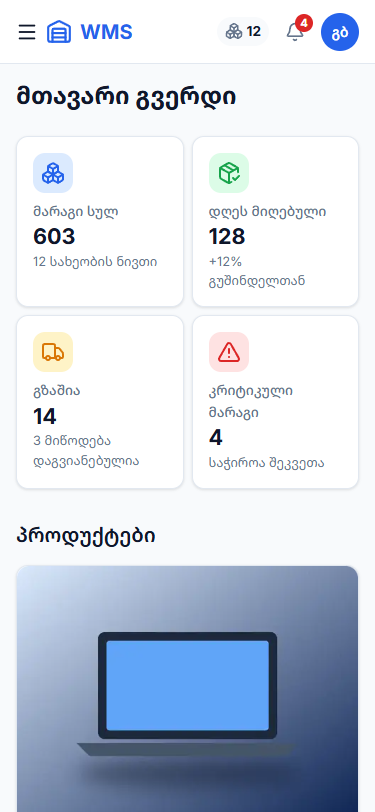

# 📦 WMS — საწყობის მართვა, ერთ ეკრანზე

🔗 **Live Demo:** **[https://finally-project-3lf1.vercel.app](https://finally-project-3lf1.vercel.app)** (სატესტო ანგარიში: `manager@wms.ge` / `Wms12345!`)
📂 **კატეგორია:** WMS — საწყობის მართვის სისტემა (ვარიანტი №2)
🎓 **მოდული:** პრაქტიკული პროექტი (Front-end პროგრამირება — 06.1.1.9)

---

## 📋 პროექტის შესახებ

**WMS** არის React-ზე დაფუძნებული თანამედროვე ვებ-აპლიკაცია საწყობის მართვისთვის. ის ცვლის ქაღალდისა და Excel-ის აღრიცხვას, სადაც საქონელი იკარგება, ნაშთი რეალობას არ ემთხვევა და პროდუქტი მოულოდნელად მთავრდება. სისტემაში მარაგები ჩანს რეალურ დროში, კრიტიკული ნაშთი ავტომატურად ინიშნება, საქონლის ჩამოწერა კი უარყოფითი ნაშთისგან დაცულია. აპლიკაცია განკუთვნილია საწყობის ოთხი ტიპის თანამშრომლისთვის: საწყობის მენეჯერი, შესყიდვების მენეჯერი, ოპერატორი და ლოჯისტიკა. თითოეულს მხოლოდ თავისი სამუშაო სივრცე და უფლებები აქვს.


| როლი | რა შეუძლია |
|---|---|
| 🧑‍💼 **საწყობის მენეჯერი** | ყველა გვერდი; პროდუქტის დამატება, რედაქტირება, წაშლა და ჩამოწერა; თანამშრომლების როლების განაწილება და დაბლოკვა |
| 🛒 **შესყიდვების მენეჯერი** | მარაგების ნახვა, კრიტიკული ნაშთის კონტროლი |
| 👷 **ოპერატორი** | მარაგების ნახვა, დაზიანებული ან დაკარგული საქონლის ჩამოწერა |
| 🚚 **ლოჯისტიკის თანამშრომელი** | მარაგების ნახვა |

> კონცეპტუალური ანალიტიკა: [პროექტის არსი და ტექნიკური ანალიტიკა](პრაქტიკული%20დავალება%2021/PROJECT_ESSENCE.md) · საბოლოო ანგარიში: [FINAL_EXAM_REPORT](პრაქტიკული%20დავალება%2023/FINAL_EXAM_REPORT.md)

---

## ✨ ძირითადი ფუნქციონალი

- **ავტორიზაცია და როლები (RBAC):** რეგისტრაცია და შესვლა ელ-ფოსტით და პაროლით (JWT, bcrypt). დაცული მარშრუტები (`ProtectedRoute`, `RoleRoute`), მენიუ და ღილაკები როლის მიხედვით. ახალი მომხმარებელი ოპერატორად რეგისტრირდება, როლს მენეჯერი ცვლის.
- **მონაცემთა მართვა (CRUD & State):** ნივთის დამატება, რედაქტირება, წაშლა და ჩამოწერა. ყველაფერი ინახება გლობალურ Store-ში (**Context API + `useReducer`**, 11 action) და სინქრონდება **`localStorage`-თან**: Refresh-ის შემდეგ რჩება ნივთებიც და ფილტრებიც. Header-ის მრიცხველი და 🔔 კრიტიკული მარაგის ნიშანი მაშინვე ახლდება, Prop Drilling-ის გარეშე.
- **ძიება და ფილტრაცია:** ცოცხალი ძიება სახელით, SKU-ით ან შტრიხკოდით (`useDebounce`, 300ms), ფილტრები კატეგორიით და სტატუსით, სორტირება. ყველაფერი მემოიზებულია (`useMemo`).
- **მოდალური ფანჯრები და ვალიდაცია:** `ReactDOM.createPortal` მოდალები (იხურება ✕-ით, ფონზე დაჭერით ან Esc-ით) და ფორმების Fail-Fast ვალიდაცია (**React Hook Form + Zod**) ქართული შეცდომებით.
- **მდგრადობა (Resilience):**
  - `ErrorBoundary` თეთრი ეკრანის წინააღმდეგ, ღილაკით „სცადეთ ხელახლა“;
  - Double-Click ბლოკირება;
  - Race Condition-ის დაცვა;
  - უარყოფითი ნაშთის დაცვა;
  - **Offline / Demo Fallback**: სერვერის გათიშვისას ჩანს ბოლოს შენახული ან დემო მონაცემები ბანერით.
- **ონლაინ ჰოსტინგი (Vercel):** ფრონტენდი და ბექენდი ერთ საიტზეა. API მუშაობს Serverless ფუნქციად (`/api`). ონლაინ ვერსიაში სერვერის მონაცემები დროებითია, ბრაუზერში კი localStorage-ში ინახება.
- **წარმადობა:** `React.lazy` + `Suspense` (მთავარი JS 429 → 267 kB), `React.memo` / `useCallback`, WebP სურათები `loading="lazy"`-ით, Event Delegation. **Lighthouse:** Performance 95–100, Accessibility, Best Practices და SEO 100.
- **Responsive დიზაინი:** CSS Grid / Flexbox ბადეები. 375px-ზე ჰამბურგერ მენიუ და ცხრილები ბარათებად, 768px-ზე პლანშეტის ვერსია, 1440px-ზე დესკტოპი. შემოწმებულია Chrome-ში, Edge-სა და Firefox-ში.
- **ხელმისაწვდომობა (a11y):** სემანტიკური HTML5, კლავიატურით ნავიგაცია, `:focus-visible`, `aria-*`, კონტრასტი WCAG AA.

| მოდალი და ვალიდაცია | მობილური (375px) |
|---|---|
|  |  |

---

## 🛠 ტექნოლოგიური სტეკი

| კატეგორია | გამოყენებული ტექნოლოგია |
| :--- | :--- |
| **Core** | React 19, Vite, TypeScript |
| **State Management** | Context API + `useReducer` (გლობალური Store) + LocalStorage |
| **Forms & Validation** | React Hook Form + Zod |
| **Routing & Performance** | React Router (`React.lazy` & `Suspense`) |
| **Styling & Icons** | Tailwind CSS v4 + CSS Variables (Design Tokens), კომპონენტური CSS (BEM), Lucide React (SVG) |
| **HTTP / API** | Fetch API (საერთო `apiClient` სერვისის ფენით, JWT ჰედერით) |
| **Backend (Mock API)** | json-server + json-server-auth (JWT, bcrypt) |
| **Hosting** | Vercel (სტატიკური საიტი + Serverless API ფუნქცია `api/index.js`) |
| **Code Quality** | TypeScript strict, Prettier, Oxlint |

---

## 📁 პროექტის სტრუქტურა

```text
wms-app/
├── api/index.js        # Vercel Serverless API (json-server + json-server-auth, მეხსიერებაში)
├── db.json             # მონაცემთა ბაზა (json-server): items, users, vendors, orders…
├── vercel.json         # Vercel-ის კონფიგურაცია (build, /api, SPA rewrites)
├── public/images/      # ოპტიმიზებული WebP სურათები
└── src/
    ├── components/     # ხელახლა გამოყენებადი UI კომპონენტები (Header, Sidebar, Modal, Button, ErrorBoundary…)
    ├── pages/          # აპლიკაციის გვერდები (auth, dashboard, inventory, users, errors)
    ├── store/          # გლობალური სთეით-მენეჯმენტი (InventoryContext + useReducer + localStorage)
    ├── hooks/          # Custom ჰუკები (useItems, useInventoryFilters, useDebounce, useEventDelegation, useUsers)
    ├── services/       # API სერვისები (apiClient, itemService, authService, userService)
    ├── context/        # AuthContext — სესია და უფლებები
    ├── config/         # როლები და უფლებები (ერთი წყარო)
    ├── routes/         # ProtectedRoute, GuestRoute, RoleRoute
    ├── schemas/        # Zod ვალიდაციის სქემები
    ├── types/          # ტიპებისა და მოდელების აღწერა
    └── utils/          # დამხმარე სუფთა ფუნქციები (სტატუსი, ფასი, სორტირება)
```

---

## ⚙ ლოკალურად გაშვების ინსტრუქცია

**საჭიროა:** [Node.js](https://nodejs.org/) 20+ და Git.

1. **დააკლონირეთ რეპოზიტორია:**
   ```bash
   git clone https://github.com/Iobis21/finally-project.git
   cd finally-project/wms-app
   ```
2. **დააყენეთ პაკეტები:**
   ```bash
   npm install
   ```
3. **გაუშვით დეველოპერული სერვერი** (ერთდროულად ეშვება საიტი და API):
   ```bash
   npm run dev
   ```
   გახსენით ბრაუზერში: `http://localhost:5173` (API: `http://localhost:3000`)

> არასავალდებულო: `cp .env.example .env`, სადაც შეგიძლიათ შეცვალოთ `VITE_API_URL`.

---

## 🔐 სატესტო ანგარიშები

პაროლი ყველასთვის: **`Wms12345!`**

| როლი | ელფოსტა | პაროლი |
| :--- | :--- | :--- |
| **საწყობის მენეჯერი** (ყველა უფლება) | `manager@wms.ge` | `Wms12345!` |
| **შესყიდვების მენეჯერი** | `purchasing@wms.ge` | `Wms12345!` |
| **ოპერატორი** | `operator@wms.ge` | `Wms12345!` |
| **ლოჯისტიკის თანამშრომელი** | `logistics@wms.ge` | `Wms12345!` |

ახალი ანგარიში შეიძლება შეიქმნას `/register` გვერდზე და მიიღებს როლს „ოპერატორი“.

---

## 📜 ხელმისაწვდომი სკრიპტები

ბრძანებები ეშვება `wms-app/` საქაღალდეში:

- `npm run dev`: დეველოპერული სერვერი (Vite, :5173) და API (json-server, :3000);
- `npm run build`: საწარმოო (Production) ვერსიის აწყობა (`tsc -b && vite build` → `dist/`);
- `npm run preview`: აწყობილი ვერსიის ლოკალურად გაშვება;
- `npm run lint`: კოდის შემოწმება (Oxlint);
- `npm run format`: კოდის დაფორმატება (Prettier);
- `npm run server`: მხოლოდ API (json-server + json-server-auth).

---

## 📚 პრაქტიკული დავალებები

<details>
<summary>ყველა დავალების დოკუმენტაცია (1–23)</summary>

| # | დავალება |
|---|---|
| 1 | [ტექნიკური დავალება და დაგეგმარება](პრაქტიკული%20დავალება%201/TECH_SPEC.md) |
| 2 | [როლები, თასქები, Timeline, API ენდფოინთები](პრაქტიკული%20დავალება%202/DAVALEBA_2.md) |
| 3 | [Story Points, კანბან დაფა, გლობალური სტილები](პრაქტიკული%20დავალება%203/DAVALEBA_3.md) |
| 4 | [ფუნქციონალური ანალიტიკა და ვალიდაცია](პრაქტიკული%20დავალება%204/DAVALEBA_4.md) |
| 5 | [ტექნიკური დავალება და არქიტექტურა](პრაქტიკული%20დავალება%205/DAVALEBA_5.md) |
| 6 | [UX: საქონლის მიღების სცენარი](პრაქტიკული%20დავალება%206/DAVALEBA_6.md) |
| 7 | [UX: შესყიდვის შეკვეთის სცენარი](პრაქტიკული%20დავალება%207/DAVALEBA_7.md) |
| 8 | [სემანტიკური HTML5 სკელეტი](პრაქტიკული%20დავალება%208/README.md) |
| 9 | [Dashboard ლეიაუთი (Grid + Flexbox)](პრაქტიკული%20დავალება%209/DAVALEBA_9.md) |
| 10 | [UI/UX აუდიტი და QA ანგარიში](პრაქტიკული%20დავალება%2010/DAVALEBA_10.md) |
| 11 | [ინტერაქციული მართვის პანელი (CRUD, Modal, Portal)](პრაქტიკული%20დავალება%2011/DAVALEBA_11.md) |
| 12 | [მიკრო-ინტერაქციები, Debounce, Event Delegation, a11y](პრაქტიკული%20დავალება%2012/DAVALEBA_12.md) |
| 13 | [რეფაქტორიზაცია: SOLID, services](პრაქტიკული%20დავალება%2013/DAVALEBA_13.md) |
| 15 | [Error Boundary, ოფლაინ რეჟიმი, დებაგინგის ჟურნალი](პრაქტიკული%20დავალება%2015/DAVALEBA_15.md) |
| 16 | [ოპტიმიზაცია: memo, Lazy Loading, WebP](პრაქტიკული%20დავალება%2016/DAVALEBA_16.md) |
| 17 | [ტექნიკური აუდიტი](პრაქტიკული%20დავალება%2017/) |
| 18 | [კროს-ბრაუზერული ტესტირება](პრაქტიკული%20დავალება%2018/TESTING.md) |
| 19 | [სთეით-მენეჯმენტი: Context + useReducer, localStorage](პრაქტიკული%20დავალება%2019/DAVALEBA_19.md) |
| 20 | [ფინალური ტექნიკური ანგარიში (Lighthouse)](პრაქტიკული%20დავალება%2020/FINAL_REPORT.md) |
| 21 | [პროექტის არსი და ტექნიკური ანალიტიკა](პრაქტიკული%20დავალება%2021/PROJECT_ESSENCE.md) |
| 22 | README.md — ეს ფაილი |
| 23 | [საბოლოო საგამოცდო ანგარიში](პრაქტიკული%20დავალება%2023/FINAL_EXAM_REPORT.md) |

**პროექტის მართვა:** [GitHub Projects — კანბან დაფა](https://github.com/users/Iobis21/projects/1)

</details>

---

## 👤 ავტორი

- **იობი შარაშენიძე** — [GitHub: @Iobis21](https://github.com/Iobis21)
