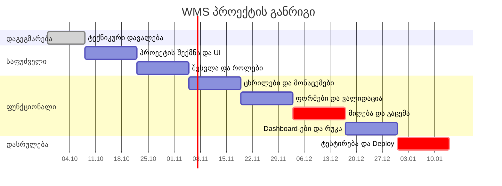

# საწყობის მართვის სისტემა (WMS) — ტექნიკური დავალება

**პროექტი:** ვარიანტი №2 — საწყობის მართვის სისტემა როლების მიხედვით  
**შესრულება:** ინდივიდუალური  
**თარიღი:** 07.10.2026  
**GitHub:** https://github.com/Iobis21/finally-project

---

## სარჩევი

1. [პროექტის აღწერა](#1-პროექტის-აღწერა)
2. [დაგეგმარება და ინსტრუმენტები](#2-დაგეგმარება-და-ინსტრუმენტები)
3. [ტექნოლოგიური სტეკი](#3-ტექნოლოგიური-სტეკი)
4. [როლები და ფუნქციონალი](#4-როლები-და-ფუნქციონალი)
5. [გვერდები და მარშრუტები](#5-გვერდები-და-მარშრუტები)
6. [ფოლდერების სტრუქტურა](#6-ფოლდერების-სტრუქტურა)
7. [კომპონენტების იერარქია](#7-კომპონენტების-იერარქია)
8. [მონაცემების სტრუქტურა](#8-მონაცემების-სტრუქტურა)
9. [რისკების ანალიზი](#9-რისკების-ანალიზი)
10. [ვადების განრიგი (Timeline)](#10-ვადების-განრიგი)

---

## 1. პროექტის აღწერა

სამი ვარიანტიდან ავირჩიე საწყობის მართვის სისტემა (WMS), რადგან ის ყველაზე კარგად აჩვენებს React-ის იმ თემებს, რაც კურსზე გავიარეთ: ცხრილები, ფორმები, ვალიდაცია, მარშრუტიზაცია და როლების მიხედვით წვდომა.

აპლიკაციაში შედის ოთხი ტიპის თანამშრომელი. თითოეული სისტემაში შესვლის შემდეგ ხედავს მხოლოდ თავის სამუშაო გვერდებს:

- **საწყობის მენეჯერი** — ხედავს მთელ საწყობს, მარაგებს, რუკას და ანგარიშებს;
- **შესყიდვების მენეჯერი** — ქმნის შესყიდვის შეკვეთებს და მუშაობს მომწოდებლებთან;
- **ოპერატორი** — იღებს და გასცემს საქონელს შტრიხკოდის სკანირებით;
- **ლოჯისტიკის თანამშრომელი** — აკონტროლებს მიწოდებებს და კურიერებს.

რეალური backend პროექტში არ მაქვს, ამიტომ მონაცემებისთვის გამოვიყენებ **json-server**-ს — ის `db.json` ფაილიდან ქმნის ყალბ REST API-ს.

---

## 2. დაგეგმარება და ინსტრუმენტები

### 2.1 გუნდი

პროექტს ვაკეთებ მარტო, ამიტომ ყველა როლს მე ვასრულებ:

| როლი | რას ვაკეთებ ამ როლში |
|---|---|
| ლიდერი | ვგეგმავ თასქებს და ვაკონტროლებ ვადებს |
| არქიტექტორი | ვწყვეტ ფოლდერების სტრუქტურას, მარშრუტებს და მონაცემების ტიპებს |
| UI/UX | ვაწყობ დიზაინს Tailwind-ით, ვაკეთებ კომპონენტებს |
| დეველოპერი | ვწერ გვერდებს, ფორმებს და ცხრილებს |

### 2.2 ინსტრუმენტები

| რისთვის | რას ვიყენებ |
|---|---|
| ვერსიების კონტროლი | **Git + GitHub** — [Iobis21/finally-project](https://github.com/Iobis21/finally-project) |
| თასქების მართვა | **GitHub Projects** — Kanban დაფა სვეტებით: To Do → In Progress → Done |
| დოკუმენტაცია | **GitHub Wiki** და `README.md` — აქ ინახება ეს დოკუმენტი, რისკები და Timeline |
| Deploy | **Vercel** — ბოლოს ავტვირთავ პროექტს ინტერნეტში |

GitHub Projects ავირჩიე, რადგან კოდიც და თასქებიც ერთ ადგილას იქნება და ცალკე Trello ან Jira არ დამჭირდება.

### 2.3 Git-ით მუშაობა

- `main` ბრენჩზე ინახება მუშა ვერსია;
- ყოველ ახალ ფუნქციაზე ვხსნი ცალკე ბრენჩს, მაგ. `feature/login`, და დასრულების შემდეგ ვაერთიანებ `main`-ში;
- commit-ებს ვწერ გასაგებად, მაგ. `add login page`, `fix inventory table sorting`.

---

## 3. ტექნოლოგიური სტეკი

| ტექნოლოგია | რატომ |
|---|---|
| **React** | მთავარი ბიბლიოთეკა, რომელიც კურსზე ვისწავლე |
| **Vite** | სწრაფად ქმნის React პროექტს და აქვს სწრაფი dev სერვერი |
| **TypeScript** | ტიპები მეხმარება შეცდომების ადრე პოვნაში — ბევრი მონაცემი მაქვს (ნივთები, შეკვეთები, მომხმარებლები) |
| **Tailwind CSS** | სტილებს ვწერ პირდაპირ კლასებით, სწრაფია და რესპონსივობაც მარტივია |
| **React Router** | გვერდებს შორის ნავიგაცია და დაცული მარშრუტები |
| **React Hook Form + Zod** | ფორმები და მათი ვალიდაცია (პირობაში მოთხოვნილია) |
| **TanStack Table** | ცხრილები პაგინაციით, სორტირებით და ფილტრაციით (პირობაში მოთხოვნილია) |
| **Recharts** | გრაფიკები Dashboard-ებზე |
| **json-server** | ყალბი API, რომ backend-ის გარეშე ვიმუშაო |

გლობალური მონაცემებისთვის (ვინ არის შესული სისტემაში) გამოვიყენებ **React Context**-ს.

---

## 4. როლები და ფუნქციონალი

### საწყობის მენეჯერი
- Dashboard: მთავარი მაჩვენებლები და გრაფიკები;
- მარაგების ცხრილი და ნივთის დეტალები;
- საწყობის ვიზუალური რუკა (ზონები და თაროები);
- წუნდებული საქონლის აღრიცხვა;
- შესყიდვის შეკვეთების დამტკიცება ან უარყოფა;
- თანამშრომლების მართვა და ანგარიშები.

### შესყიდვების მენეჯერი
- მომწოდებლების სია;
- შესყიდვის შეკვეთის (Purchase Order) შექმნა;
- შეტყობინება, როცა რომელიმე ნივთის მარაგი კრიტიკულ ზღვარს ქვემოთ ჩამოდის.

### ოპერატორი
- საქონლის მიღება (Inbound) — შტრიხკოდის სკანირება და რაოდენობის შემოწმება;
- საქონლის გაცემა (Outbound) — შეგროვება (Picking) და შეფუთვა (Packing).

შტრიხკოდის სკანერს ვაკეთებ იმიტაციით: ოპერატორი ველში წერს კოდს და აჭერს Enter-ს, ან აჭერს ღილაკს „სკანირების სიმულაცია".

### ლოჯისტიკის თანამშრომელი
- მიწოდებების სია;
- კურიერის არჩევა;
- მიწოდების სტატუსის შეცვლა (გზაშია, მიწოდებულია და ა.შ.).

### უფლებების ცხრილი

| მოქმედება | საწყობის მენეჯერი | შესყიდვები | ოპერატორი | ლოჯისტიკა |
|---|:---:|:---:|:---:|:---:|
| მარაგების ნახვა | ✅ | ✅ | ✅ | ✅ |
| მარაგის კორექტირება | ✅ | ❌ | ✅ | ❌ |
| საქონლის მიღება | ✅ | ❌ | ✅ | ❌ |
| საქონლის გაცემა | ❌ | ❌ | ✅ | ❌ |
| შეკვეთის შექმნა | ❌ | ✅ | ❌ | ❌ |
| შეკვეთის დამტკიცება | ✅ | ❌ | ❌ | ❌ |
| მომწოდებლები | ✅ | ✅ | ❌ | ❌ |
| მიწოდებები | ✅ | ❌ | ❌ | ✅ |
| საწყობის რუკა | ✅ | ❌ | ❌ | ❌ |
| თანამშრომლების მართვა | ✅ | ❌ | ❌ | ❌ |
| ანგარიშები | ✅ | ✅ | ❌ | ❌ |

---

## 5. გვერდები და მარშრუტები

| მარშრუტი | გვერდი | ვის შეუძლია შესვლა |
|---|---|---|
| `/login` | შესვლა | ყველას (შესვლამდე) |
| `/` | Dashboard (თითო როლს თავისი) | ყველა შესულს |
| `/inventory` | მარაგების ცხრილი | ყველა |
| `/inventory/:id` | ნივთის დეტალები | ყველა |
| `/inventory/adjust` | მარაგის კორექტირება / წუნი | მენეჯერი, ოპერატორი |
| `/inbound` | შემოსული ტვირთების სია | მენეჯერი, შესყიდვები, ოპერატორი |
| `/inbound/:id` | საქონლის მიღება (სკანირება) | მენეჯერი, ოპერატორი |
| `/outbound` | გასაცემი შეკვეთები | მენეჯერი, ოპერატორი, ლოჯისტიკა |
| `/outbound/pick/:id` | შეგროვება | ოპერატორი |
| `/outbound/pack/:id` | შეფუთვა | ოპერატორი |
| `/orders` | შესყიდვის შეკვეთები | მენეჯერი, შესყიდვები |
| `/orders/new` | ახალი შეკვეთის შექმნა | შესყიდვები |
| `/orders/:id` | შეკვეთის დეტალები / დამტკიცება | მენეჯერი, შესყიდვები |
| `/vendors` | მომწოდებლები | მენეჯერი, შესყიდვები |
| `/deliveries` | მიწოდებები | მენეჯერი, ლოჯისტიკა |
| `/map` | საწყობის რუკა | მენეჯერი |
| `/users` | თანამშრომლები | მენეჯერი |
| `/reports` | ანგარიშები | მენეჯერი, შესყიდვები |
| `/profile` | ჩემი პროფილი | ყველა |
| `*` | 404 გვერდი | ყველა |

**როგორ ვიცავ გვერდებს:**
- `ProtectedRoute` — თუ მომხმარებელი არ არის შესული, გადაჰყავს `/login`-ზე;
- `RoleRoute` — თუ მომხმარებლის როლს არ აქვს წვდომა, აჩვენებს „წვდომა აკრძალულია" გვერდს.

```tsx
<Route element={<ProtectedRoute />}>
  <Route path="/" element={<Dashboard />} />
  <Route path="/inventory" element={<InventoryPage />} />

  <Route element={<RoleRoute allowed={["manager"]} />}>
    <Route path="/users" element={<UsersPage />} />
    <Route path="/map" element={<WarehouseMapPage />} />
  </Route>
</Route>
```

---

## 6. ფოლდერების სტრუქტურა

```
src/
├── api/            # json-server-თან მოთხოვნები (getItems, createOrder...)
├── components/     # რეიუზებადი კომპონენტები
│   ├── ui/         # Button, Input, Modal, Badge, Card
│   ├── table/      # DataTable (TanStack Table), Pagination
│   └── layout/     # Sidebar, Header
├── context/        # AuthContext — ვინ არის შესული
├── routes/         # ProtectedRoute, RoleRoute
├── hooks/          # useAuth, useDebounce, useBarcodeScanner
├── pages/          # გვერდები, დაჯგუფებული თემების მიხედვით
│   ├── auth/
│   ├── dashboard/
│   ├── inventory/
│   ├── inbound/
│   ├── outbound/
│   ├── orders/
│   ├── vendors/
│   ├── deliveries/
│   ├── users/
│   └── reports/
├── schemas/        # Zod სქემები ფორმებისთვის
├── types/          # TypeScript ტიპები
├── utils/          # დამხმარე ფუნქციები (თარიღის, ფასის ფორმატირება)
├── App.tsx         # მარშრუტები
└── main.tsx        # აპლიკაციის გაშვება
db.json             # json-server-ის მონაცემები
```

**ლოგიკა:** `components/`-ში არის ზოგადი ნაწილები, რომლებსაც ბევრ გვერდზე ვიყენებ, `pages/`-ში კი თითო გვერდი, რომელიც ამ ნაწილებს აერთიანებს.

---

## 7. კომპონენტების იერარქია

მაგალითად ავიღე ყველაზე რთული გვერდი — **საქონლის მიღება** (`/inbound/:id`), სადაც ოპერატორი ასკანერებს შემოსულ საქონელს და ადარებს შეკვეთას.

```
ReceivingPage                  ← მთავარი კომპონენტი, აქ ინახება state
├── Layout (Sidebar + Header)
├── ShipmentInfo               ← ტვირთის ნომერი, მომწოდებელი, სტატუსი
├── BarcodeScanner             ← შტრიხკოდის ველი + „სიმულაციის" ღილაკი
│   └── ScanMessage            ← „ნაპოვნია" / „ასეთი ნივთი არ არის შეკვეთაში"
├── ItemsTable                 ← მოსალოდნელი და მიღებული რაოდენობები
│   └── Badge                  ← სხვაობა (მეტი / ნაკლები / სწორი)
├── DamageModal                ← დაზიანებული საქონლის ფორმა (RHF + Zod)
└── Button „მიღების დასრულება"
```

**მონაცემები როგორ მოძრაობს:**
1. `ReceivingPage` წამოიღებს ტვირთის მონაცემებს API-დან;
2. `BarcodeScanner` სკანირებისას იძახებს `onScan(code)` ფუნქციას, რომელიც მშობელმა გადასცა props-ით;
3. `ReceivingPage` ზრდის შესაბამისი ნივთის რაოდენობას state-ში;
4. `ItemsTable` იღებს განახლებულ მონაცემებს props-ით და ხელახლა რენდერდება.

ანუ state ინახება მშობელში, შვილებს მონაცემები props-ით გადაეცემა, ხოლო მოვლენები უკან callback ფუნქციებით ბრუნდება (lifting state up).

---

## 8. მონაცემების სტრუქტურა

```typescript
// types/index.ts

export type Role = "manager" | "purchasing" | "operator" | "logistics";

export interface User {
  id: number;
  name: string;
  email: string;
  role: Role;
}

export interface Item {
  id: number;
  sku: string;          // საქონლის კოდი
  barcode: string;      // შტრიხკოდი
  name: string;
  category: string;
  quantity: number;     // რამდენია საწყობში
  minQuantity: number;  // ამაზე ნაკლები = კრიტიკული მარაგი
  price: number;
  location: string;     // თაროს მისამართი, მაგ. "A-03-02"
}

export interface Vendor {
  id: number;
  name: string;
  phone: string;
  email: string;
}

export type OrderStatus = "draft" | "pending" | "approved" | "rejected" | "received";

export interface PurchaseOrder {
  id: number;
  number: string;       // მაგ. "PO-0012"
  vendorId: number;
  status: OrderStatus;
  createdAt: string;
  items: { itemId: number; quantity: number; price: number }[];
}

export interface Shipment {
  id: number;
  orderId: number;
  status: "expected" | "receiving" | "completed";
  items: { itemId: number; expected: number; received: number; damaged: number }[];
}

export type DeliveryStatus = "waiting" | "in_transit" | "delivered" | "failed";

export interface Delivery {
  id: number;
  orderNumber: string;
  courier: string;
  address: string;
  status: DeliveryStatus;
}
```

**ვალიდაციის მაგალითი (Zod):**

```typescript
// schemas/order.schema.ts
import { z } from "zod";

export const orderSchema = z.object({
  vendorId: z.number({ message: "აირჩიეთ მომწოდებელი" }),
  items: z
    .array(
      z.object({
        itemId: z.number(),
        quantity: z.number().min(1, "რაოდენობა უნდა იყოს მინიმუმ 1"),
      })
    )
    .min(1, "დაამატეთ მინიმუმ ერთი ნივთი"),
});
```

---

## 9. რისკების ანალიზი

| რისკი | ალბათობა | გავლენა | რას ვაკეთებ |
|---|:---:|:---:|---|
| პროექტი დიდია და მარტო ვაკეთებ | მაღალი | მაღალი | ჯერ ვაკეთებ მთავარ ნაწილს (შესვლა, როლები, მარაგები, მიღება), დანარჩენს — მერე |
| ახალი ბიბლიოთეკები (TypeScript, TanStack Table, Zod) | საშუალო | საშუალო | ჯერ ვსწავლობ პატარა მაგალითზე, მერე ვამატებ პროექტში |
| backend არ მაქვს | დარწმუნებით | საშუალო | ვიყენებ json-server-ს |
| ვადების გადაცილება | საშუალო | მაღალი | ყოველ კვირას ვამოწმებ GitHub Projects-ის დაფას |
| როლი ხედავს გვერდს, რომელიც არ უნდა ნახოს | საშუალო | მაღალი | უფლებები ერთ ფაილში მაქვს და ყველა როლით ვამოწმებ |
| კოდის დაკარგვა | დაბალი | მაღალი | ხშირად ვაკეთებ commit-ს და push-ს GitHub-ზე |

---

## 10. ვადების განრიგი

| კვირა | რას ვაკეთებ |
|---|---|
| 1 (28.09 – 07.10) | დაგეგმარება, ტექნიკური დავალება, GitHub და Projects დაფა |
| 2 – 3 | პროექტის შექმნა (Vite, Tailwind), ფოლდერები, UI კომპონენტები |
| 4 – 5 | შესვლა, როლები, მარშრუტები, Sidebar |
| 6 – 7 | json-server, მარაგების ცხრილი (პაგინაცია, სორტირება, ფილტრი) |
| 8 – 9 | ფორმები და ვალიდაცია: შეკვეთები, მომწოდებლები, კორექტირება |
| 10 – 11 | მიღება და გაცემა, შტრიხკოდის სკანირება |
| 12 – 13 | Dashboard-ები, გრაფიკები, საწყობის რუკა, მიწოდებები |
| 14 – 15 | ტესტირება, შეცდომების გასწორება, Vercel, პრეზენტაცია |


