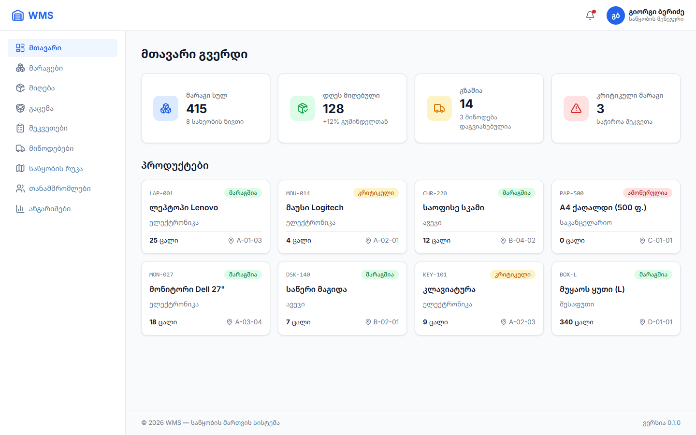
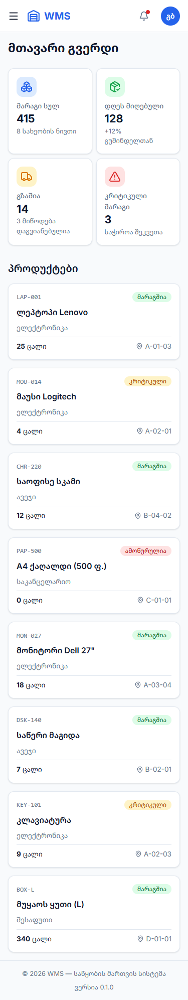
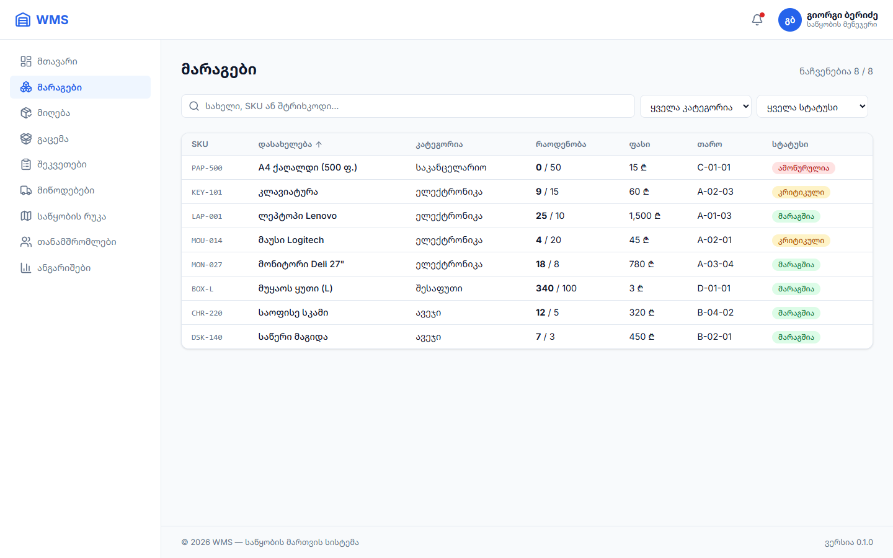
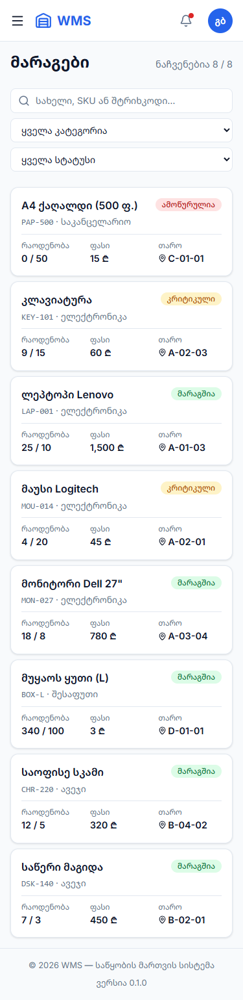
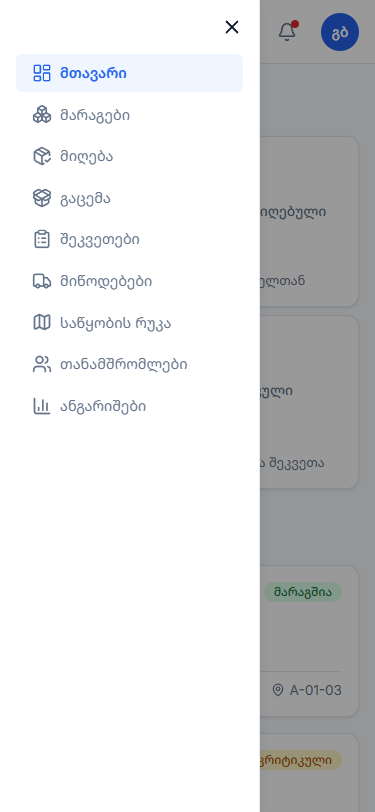
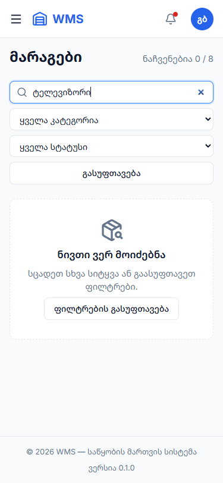
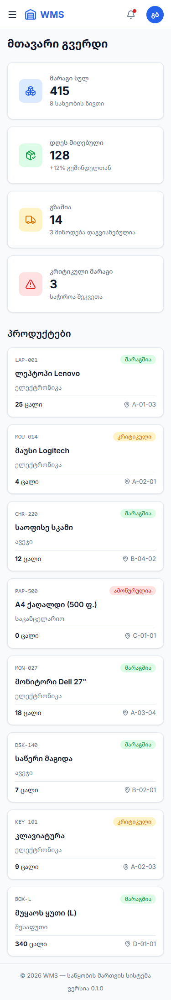

# პრაქტიკული დავალება 10 — UI/UX ანალიზიდან ინტერფეისის ინჟინერიამდე

**პროექტი:** საწყობის მართვის სისტემა (WMS)  
**მოდული:** Dashboard + მარაგების გვერდი (Inventory)  
**კოდი:** [wms-app/src/](../wms-app/src/) · **სქრინები:** [screenshots/](screenshots/)

Figma მაკეტის ნაცვლად დიზაინი პირდაპირ კოდში ავაწყე და სქრინები გადავიღე ორ ზომაზე: **1440px** (დესკტოპი) და **375px** (მობილური).

---

## ეტაპი 1: UI/UX ანალიზი და დიზაინ-აუდიტი

### 1.1 Design Tokens

ყველა ტოკენი ერთ ფაილშია: [wms-app/src/index.css](../wms-app/src/index.css)

#### ფერები

| ტოკენი | HEX | სად გამოიყენება |
|---|---|---|
| `--primary` / `primary-600` | `#2563EB` | ღილაკები, აქტიური მენიუ, ლოგო, ბმულები |
| `primary-700` | `#1D4ED8` | ღილაკის hover |
| `primary-50` | `#EFF6FF` | აქტიური მენიუს ფონი |
| `--bg` | `#F8FAFC` | გვერდის ფონი |
| `--surface` | `#FFFFFF` | ბარათები, ცხრილი, Header, Sidebar |
| `--border` | `#E2E8F0` | საზღვრები |
| `--text` | `#0F172A` | მთავარი ტექსტი |
| `--text-muted` | `#64748B` | მეორეხარისხოვანი ტექსტი |
| `success` / ტექსტი | `#DCFCE7` / `#15803D` | „მარაგშია" |
| `warning` / ტექსტი | `#FEF3C7` / `#B45309` | „კრიტიკული" |
| `danger` / ტექსტი | `#FEE2E2` / `#B91C1C` | „ამოწურულია" |
| `info` / ტექსტი | `#CFFAFE` / `#0E7490` | „გზაშია" |

#### ტიპოგრაფია

**ფონტები:** Inter (ლათინური) + Noto Sans Georgian (ქართული) · SKU და კოდები: monospace

| დონე | ზომა | წონა | სად |
|---|---|---|---|
| H1 | 24px (1.5rem) | 700 | გვერდის სათაური |
| H2 | 20px (1.25rem) | 600 | სექციის სათაური |
| KPI რიცხვი | 25.6px (1.6rem) / მობ. 21.6px | 700 | სტატისტიკის კარტა |
| H3 / ბარათის სათაური | 16px (1rem) | 600 | პროდუქტის სახელი |
| Body | 14–15px | 400 | ცხრილი, ტექსტი |
| Small | 12–13px | 400–500 | Badge, SKU, ხელმოწერები |

**ხაზის სიმაღლე:** 1.5 (ტექსტი), 1.2 (რიცხვები)

#### ინტერვალები (8px ბადე)

| ტოკენი | მნიშვნელობა | სად |
|---|---|---|
| `--space-xs` | 4px (½ ბიჯი) | იკონა და ტექსტი |
| `--space-sm` | 8px | ბარათებს შორის მობილურზე, ღილაკის შიგნით |
| `--space-md` | 16px | ბარათის შიგნით, ბადის gap |
| `--space-lg` | 24px | კარტის padding, სექციებს შორის |
| `--space-xl` | 32px | გვერდის padding დესკტოპზე |

ყველა ზომა 8-ის ჯერადია (4px მხოლოდ წვრილმანი დეტალებისთვის). ლეიაუთის ზომებიც: Sidebar **260px**, Header **64px** (8 × 8).

#### სხვა

| ტოკენი | მნიშვნელობა |
|---|---|
| `--radius-sm` | 6px (ღილაკი, მენიუს ელემენტი) |
| `--radius-md` | 12px (ბარათები) |
| `--shadow-sm` | `0 1px 3px rgb(0 0 0 / .08)` |
| `--shadow-md` | `0 4px 12px rgb(0 0 0 / .08)` (hover, ღია მენიუ) |

### 1.2 Responsive State Analysis — 1440px vs 375px

| Dashboard 1440px | Dashboard 375px |
|---|---|
|  |  |

| მარაგები 1440px | მარაგები 375px |
|---|---|
|  |  |

| მობილური მენიუ (გახსნილი) | ცარიელი შედეგი (Empty State) |
|---|---|
|  |  |

#### რა იცვლება ეკრანის დაპატარავებისას

| ელემენტი | 1440px | 375px | როგორ |
|---|---|---|---|
| **Sidebar** | მუდმივად ჩანს მარცხნივ, 260px | იმალება; ☰ ღილაკით გამოდის მარცხნიდან, ფონი მუქდება | `@media (max-width: 768px)` + `transform` |
| **Header** | ლოგო · ზარი · ავატარი + სახელი და როლი | ☰ · ლოგო · ზარი · მხოლოდ ავატარი | სახელი `display: none` |
| **გვერდის ლეიაუთი** | Grid: 2 სვეტი (`260px 1fr`) | 1 სვეტი | `grid-template-columns: 1fr` |
| **KPI კარტები** | 4 ერთ ხაზზე, იკონა ტექსტის გვერდით | 2 × 2, იკონა ტექსტის ზემოთ, უფრო პატარა | `auto-fit` + `@media (max-width: 480px)` |
| **პროდუქტების ბადე** | 4 სვეტი | 1 სვეტი | `auto-fill, minmax(240px, 1fr)` — მედია-ქიერის გარეშე |
| **მარაგების ცხრილი** | ცხრილი 7 სვეტით, სორტირება სათაურებზე | **ბარათები** — სახელი + სტატუსი ზემოთ, რაოდენობა / ფასი / თარო ქვემოთ | `@media (min-width: 900px)` ცვლის ცხრილს/ბარათებს |
| **ფილტრები** | ერთ ხაზზე: ძებნა + 2 select | ერთმანეთის ქვეშ, მთელ სიგანეზე | Grid `1fr` → `1fr 180px 180px auto` (≥640px) |
| **გვერდის padding** | 32px | 16px | `--space-xl` → `--space-md` |
| **Footer** | ორ მხარეს (`space-between`) | ცენტრში, ერთმანეთის ქვეშ | `flex-wrap` + `text-align: center` |

**Breakpoint-ები:** 480px (ძალიან ვიწრო) · 640px (ფილტრები) · 768px (Sidebar) · 900px (ცხრილი)

---

## ეტაპი 2: პროგრამული იმპლემენტაცია

### 2.1 არქიტექტურა — კომპონენტები

```
src/
├── components/                   ← რეიუზებადი (Presentational)
│   ├── Layout/        Layout.tsx + Layout.css        Grid ლეიაუთი, მენიუს state, <Outlet />
│   ├── Header/        Header.tsx + Header.css
│   ├── Sidebar/       Sidebar.tsx + Sidebar.css      NavLink — აქტიური გვერდი ავტომატურად
│   ├── Footer/
│   ├── StatCard/
│   ├── ProductCard/
│   └── EmptyState/    EmptyState.tsx + .css          „ვერ მოიძებნა" ბლოკი (ახალი)
├── pages/                        ← გვერდები (Container)
│   ├── dashboard/     DashboardPage
│   ├── inventory/     InventoryPage                  ძებნა, ფილტრები, სორტირება (ახალი)
│   └── errors/        NotFoundPage, ComingSoonPage   (ახალი)
├── utils/stock.ts                ← getStockStatus(), formatPrice() (ახალი)
├── App.tsx                       ← მარშრუტები (React Router)
└── index.css                     ← Design Tokens
```

### 2.2 BEM მეთოდოლოგია

ყველა კომპონენტის CSS დაწერილია BEM-ით — **ბლოკი__ელემენტი--მოდიფიკატორი**:

```css
.sidebar { }                      /* ბლოკი */
.sidebar__link { }                /* ელემენტი */
.sidebar__link--active { }        /* მოდიფიკატორი */
.sidebar--open { }                /* ბლოკის მოდიფიკატორი */

.inventory-card { }
.inventory-card__top { }
.inventory-card__details { }
```

ასე კლასები არ ეჯახება ერთმანეთს და სახელიდანვე ჩანს, რომელ კომპონენტს ეკუთვნის.

### 2.3 ადაპტაციურობა

- **Mobile-first** მარაგების გვერდზე: ჯერ მობილურის სტილები, შემდეგ `@media (min-width: ...)`;
- **Fluid Grid:** `repeat(auto-fit, minmax(...))` — კარტები თავისით გადადიან;
- **ცხრილი → ბარათები** 900px-ზე ქვემოთ;
- ცხრილს აქვს `overflow-x: auto` — თუ ვიწრო ეკრანზე მაინც ჩანს, გვერდი არ იწელება;
- **ჰორიზონტალური სქროლი არცერთ გვერდზე არ არის** — შემოწმებულია: 375px-ზე `scrollWidth = 375`.

### 2.4 ახალი ფუნქციონალი

- **React Router:** `/`, `/inventory`, დანარჩენი მენიუს გვერდები („მზადდება"), `*` → 404;
- **მარაგების გვერდი:** ძებნა (სახელი / SKU / შტრიხკოდი), ფილტრი კატეგორიით და სტატუსით, სორტირება (დასახელება / რაოდენობა / ფასი), მრიცხველი „ნაჩვენებია X / Y", Empty State.

---

## ეტაპი 3: QA და ტესტირების ანგარიში

**როგორ შევამოწმე:** Chrome DevTools (1440px და 375px), კლავიატურით ნავიგაცია, ფერების კონტრასტის გამოთვლა WCAG ფორმულით, ყველა მენიუს ბმულზე დაჭერა.

**სიმძიმე:** 🔴 მაღალი · 🟠 საშუალო · 🟢 დაბალი

### ნაპოვნი და გასწორებული ბაგები

| # | ბაგი | სიმძიმე | როგორ ვლინდება | გასწორება | სტატუსი |
|---|---|:---:|---|---|:---:|
| **BUG-01** | **Badge-ების დაბალი კონტრასტი** | 🔴 | „კრიტიკული" Badge: ტექსტი `#D97706` ღია ყვითელ ფონზე `#FEF3C7` — კონტრასტი **2.86:1**. WCAG AA მოითხოვს მინ. **4.5:1**. იგივე „მარაგშია" (3.0:1), „ამოწურულია" (3.95:1), „გზაშია" (3.29:1). მზეზე / პლანშეტზე ძნელად იკითხება | Badge-ის ტექსტისთვის ცალკე მუქი ტოკენები (`--color-warning-text: #B45309` და ა.შ.) → **4.51 / 4.57 / 5.3 / 4.79 :1** | ✅ |
| **BUG-02** | **მენიუ: აქტიური გვერდი ყოველთვის „მთავარი"** | 🔴 | Sidebar-ის ბმულები იყო ჩვეულებრივი `<a href>`: ყოველ დაჭერაზე **მთელი გვერდი თავიდან იტვირთებოდა**, აქტიური ელემენტი კოდში ხელით იყო ჩაწერილი (`active: true`) | React Router + `NavLink` — აქტიური გვერდი განისაზღვრება URL-ით, გადართვა ჩატვირთვის გარეშე | ✅ |
| **BUG-03** | **მობილური მენიუ: Esc არ მუშაობს, ფონი სქროლდება** | 🟠 | 375px-ზე მენიუს გახსნისას უკანა გვერდი სქროლავდა; Esc ღილაკით არ იხურებოდა; სხვა გვერდზე გადასვლის შემდეგ მენიუ ღია რჩებოდა; ☰ ღილაკს არ ჰქონდა `aria-expanded` (ეკრანის წამკითხველმა არ იცის, ღიაა თუ არა) | `useEffect`: Esc ხურავს, `body { overflow: hidden }`, გვერდის შეცვლისას იხურება; `aria-expanded` + `aria-controls` | ✅ |
| **BUG-04** | **375px-ზე KPI კარტები პროდუქტებს ძალიან დაბლა სწევს** | 🟠 | `minmax(220px, 1fr)` 343px სიგანეზე ტოვებს 1 სვეტს → 4 კარტა ერთმანეთის ქვეშ, **პირველი პროდუქტი იწყება ~760px-ზე** (ეკრანის მიღმა, iPhone-ის ეკრანი 812px-ია) | ≤480px: 2 × 2 კომპაქტური კარტა (იკონა ზემოთ) → პირველი პროდუქტი იწყება ~565px-ზე — ჩანს გახსნისთანავე | ✅ |
| **BUG-05** | **მენიუს ბმულები ცარიელ გვერდზე** | 🟠 | „მიღება", „შეკვეთები" და სხვ. არ არსებობდა — დაჭერისას ჩანდა იგივე Dashboard; არასწორ მისამართზე არანაირი შეტყობინება | „გვერდი მზადდება" (ComingSoonPage) + 404 გვერდი ღილაკით „მთავარზე დაბრუნება" | ✅ |

**სქრინი BUG-04-მდე და შემდეგ:**

| გასწორებამდე | გასწორების შემდეგ |
|---|---|
|  |  |

### გაუმჯობესების შემდეგი ეტაპები (ღია)

| # | პრობლემა | სიმძიმე | აღწერა | გეგმა |
|---|---|:---:|---|---|
| **IMP-01** | ორი „გასუფთავების" ღილაკი | 🟢 | Empty State-ში ჩანს „გასუფთავება" (ფილტრებთან) **და** „ფილტრების გასუფთავება" (ბლოკში) — დუბლირება | Empty State-ის დროს ზედა ღილაკის დამალვა |
| **IMP-02** | ზარი და პროფილი არ მუშაობს | 🟠 | 🔔 და ავატარზე დაჭერით არაფერი ხდება, ციფრი „3" ხელითაა ჩაწერილი | Dropdown შეტყობინებებით (json-server-იდან) და პროფილის მენიუ „გასვლით" |
| **IMP-03** | სურათების Lazy Loading | 🟢 | პროდუქტებს ჯერ სურათი არ აქვს; დამატებისას 100+ ნივთზე ყველა სურათი ერთად ჩაიტვირთება | `` — წინასწარ ჩაწერილია მოთხოვნად |
| **IMP-04** | Select-ის განსხვავებული სტილი | 🟢 | `<select>` Chrome-ში, Safari-ში და Android-ზე სხვადასხვანაირად გამოიყურება | `appearance: none` + საკუთარი ისარი |
| **IMP-05** | მუქი თემის გადამრთველი | 🟢 | `.dark` ცვლადები უკვე არსებობს, მაგრამ ჩართვის ღილაკი არ არის | Header-ში ☀/🌙 ღილაკი, არჩევანი `localStorage`-ში |
| **IMP-06** | ცხრილის პაგინაცია | 🟠 | ახლა 8 ნივთია; 500+ ნივთზე გვერდი ძალიან გრძელი იქნება | TanStack Table პაგინაციით (სპრინტი 2) |
