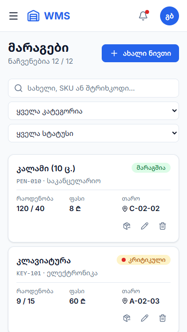
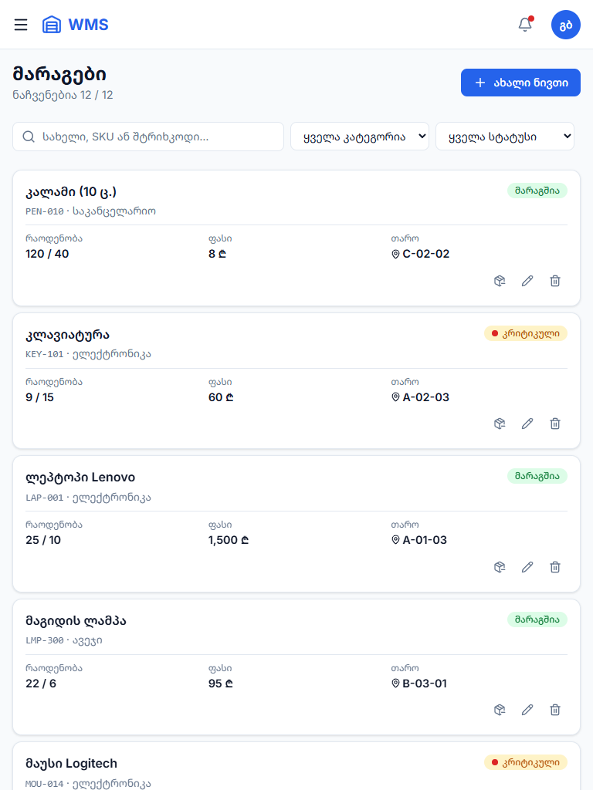
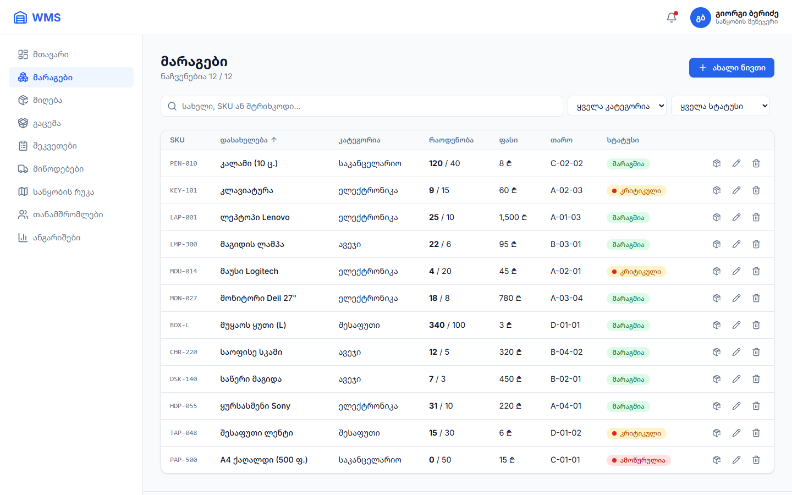
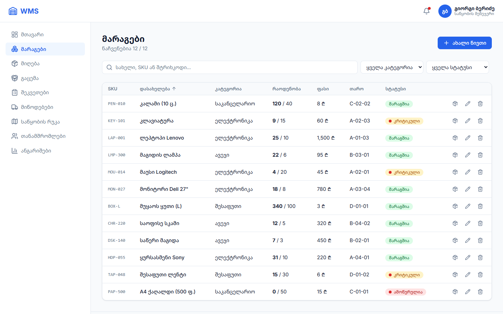
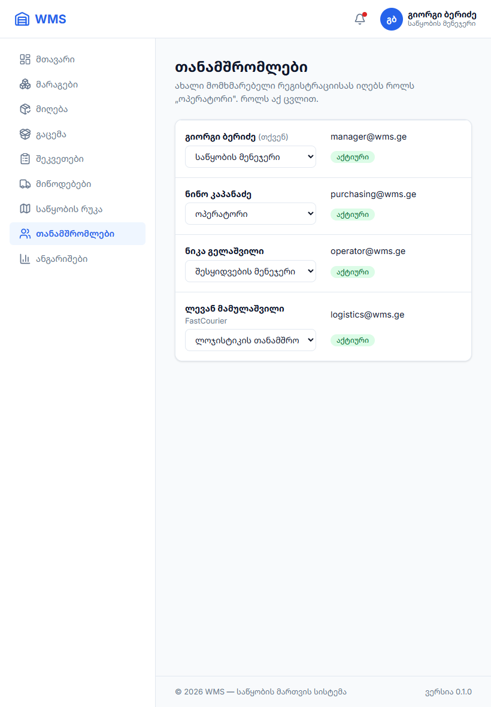

# პრაქტიკული დავალება 18 — კროს-ბრაუზერული ტესტირება და GitHub

**რეპოზიტორია:** https://github.com/Iobis21/finally-project · **README:** [../README.md](../README.md)

---

## 1. კოდის ბაზის მომზადება

| შემოწმება | შედეგი |
|---|---|
| `node_modules` რეპოზიტორიაში | ❌ არ არის (`.gitignore`) ✅ |
| `.env` ფაილები | დაემატა `.gitignore`-ში (`.env`, `.env.*`). სანიმუშოდ არის `.env.example` ✅ |
| `dist/` (build) | `.gitignore`-ში ✅ |
| დებაგის `console.log` | არცერთი ✅ |
| `console.time` / `console.table` / `console.warn` | დარჩა მხოლოდ `import.meta.env.DEV`-ში, ანუ საბოლოო ვერსიაში არ ჩანს ✅ |
| გამოუყენებელი import-ები | TypeScript `noUnusedLocals` + `noUnusedParameters`: შეცდომა არ არის ✅ |
| ცარიელი საქაღალდეები | წაიშალა (`components/table`) ✅ |
| API მისამართი | კოდში ჩაწერილის ნაცვლად `VITE_API_URL` გარემოს ცვლადიდან ✅ |

---

## 2. კროს-ბრაუზერული და რესპონსივ ტესტირება

### მეთოდი

ავტომატური ტესტი (**puppeteer**) ორ ბრაუზერში:
- **Google Chrome** 156;
- **Microsoft Edge** 156.

თითოეულში 6 ეკრანზე × 5 გვერდზე, სულ **60 კომბინაცია**. ყველა გვერდზე მოწმდება:
1. ჰორიზონტალური სქროლი (`scrollWidth > innerWidth`);
2. ტექსტი ან ღილაკი, რომელიც ეკრანიდან გადის;
3. JavaScript შეცდომები (`pageerror`).

> Firefox კომპიუტერზე დაყენებული არ არის, ამიტომ მეორე ბრაუზერად Edge გამოვიყენე. Edge-ს თავისი ქართული ენის წესები აქვს და სწორედ ამან გამოავლინა ბაგი №1.

### მოწყობილობები

| მოწყობილობა | ზომა |
|---|---|
| iPhone SE | 375 × 667 |
| iPhone 14 | 390 × 844 |
| Pixel 7 (Android) | 412 × 915 |
| iPad | 768 × 1024 |
| iPad Air | 820 × 1180 |
| დესკტოპი | 1440 × 900 |

**გვერდები:** მთავარი, მარაგები, თანამშრომლები, შესვლა, რეგისტრაცია.

### ფუნქციონალური შემოწმება (ორივე ბრაუზერში)

| ტესტი | Chrome | Edge |
|---|:---:|:---:|
| მარაგების ცხრილი: 12 ნივთი | ✅ | ✅ |
| ძებნა „ლეპ“ → 1 შედეგი (Debounce) | ✅ | ✅ |
| სორტირება დასახელებით | ✅ (გასწორების შემდეგ) | ✅ (გასწორების შემდეგ) |
| მოდალი + ფორმის ვალიდაცია (6 შეცდომა) | ✅ | ✅ |
| JavaScript შეცდომები | 0 | 0 |

---

## 3. ნაპოვნი და გასწორებული ხარვეზები

### ბაგი №1: სორტირება სხვადასხვაგვარია Chrome-სა და Edge-ში 🔴

| | |
|---|---|
| **სიმპტომი** | მარაგების სია დასახელებით: **Chrome**-ში პირველია „A4 ქაღალდი“, **Edge**-ში კი „კალამი“, ხოლო „A4 ქაღალდი“ ბოლოშია |
| **დიაგნოსტიკა** | ორივე ბრაუზერში გავუშვი `new Intl.Collator('ka').resolvedOptions().locale`. Chrome აბრუნებს **`en-GB`**, ანუ ქართული ენის წესები არ აქვს. Edge აბრუნებს **`ka`** |
| **მიზეზი** | `a.name.localeCompare(b.name, 'ka')` ბრაუზერზეა დამოკიდებული. Chrome-ში ლათინური ასოები წინ დგას, Edge-ში ქართული |
| **ფიქსი** | [utils/sort.ts](../wms-app/src/utils/sort.ts) `compareNames()`: ჯერ ქართული სახელები, მერე დანარჩენი. მხედრული Unicode-ში ანბანის რიგითაა, ამიტომ შედეგი ყველგან ერთნაირია |
| **შედეგი** | ორივე ბრაუზერში: კალამი → კლავიატურა → ლეპტოპი … → A4 ქაღალდი |

### ბაგი №2: პლანშეტზე (820px) თანამშრომლების ცხრილი იჭრება 🟠

| | |
|---|---|
| **სიმპტომი** | iPad Air-ზე Sidebar 260px-ს იკავებს და ცხრილს 560px რჩება. „სტატუსის“ სვეტი ეკრანს მიღმა გადის და მხოლოდ ჰორიზონტალური სქროლით ჩანს |
| **მიზეზი** | ცხრილი ბარათებად მხოლოდ 700px-ზე ქვემოთ იქცეოდა, როლის `select`-ს კი `min-width: 210px` ჰქონდა |
| **ფიქსი** | [UsersPage.css](../wms-app/src/pages/users/UsersPage.css): ≤1024px-ზე რიგები ბარათად იქცევა, 600–1024px-ზე ბარათის შიგნით 2 სვეტია |
| **შედეგი** | ყველა მოწყობილობაზე ყველაფერი ეტევა |

**საბოლოო შედეგი:** 60 / 60 კომბინაციაში არც ჰორიზონტალური სქროლია, არც გადაჭრილი ტექსტი და არც JS შეცდომა.

---

## 4. სქრინები

ყველა სქრინი: [screenshots/](screenshots/). ფაილის სახელის ფორმატია `ბრაუზერი-მოწყობილობა-გვერდი.png`.

| | Chrome | Edge |
|---|---|---|
| iPhone SE: მარაგები |  |  |
| iPad: მარაგები |  |  |
| დესკტოპი: მარაგები |  |  |

**თანამშრომლები, iPad Air (გასწორების შემდეგ):**

---

## 5. GitHub

- **საჯარო რეპოზიტორია:** https://github.com/Iobis21/finally-project
- **README.md** პროექტის ძირეულ საქაღალდეშია. შიგნით არის:
  - ბიზნეს-აღწერა და როლები;
  - ფუნქციონალი და ტექნოლოგიები;
  - გაშვების ინსტრუქცია (`git clone` → `npm install` → `npm run dev`);
  - სატესტო ანგარიშები;
  - პროექტის სტრუქტურა.
