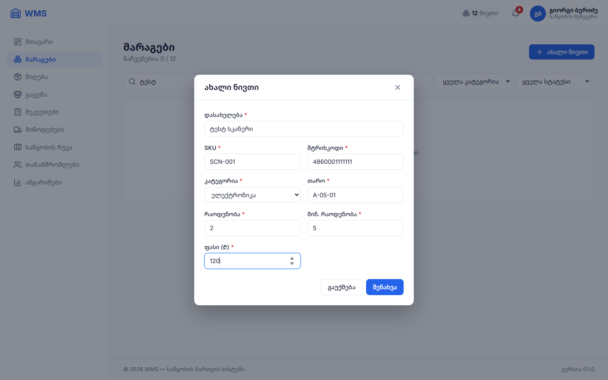
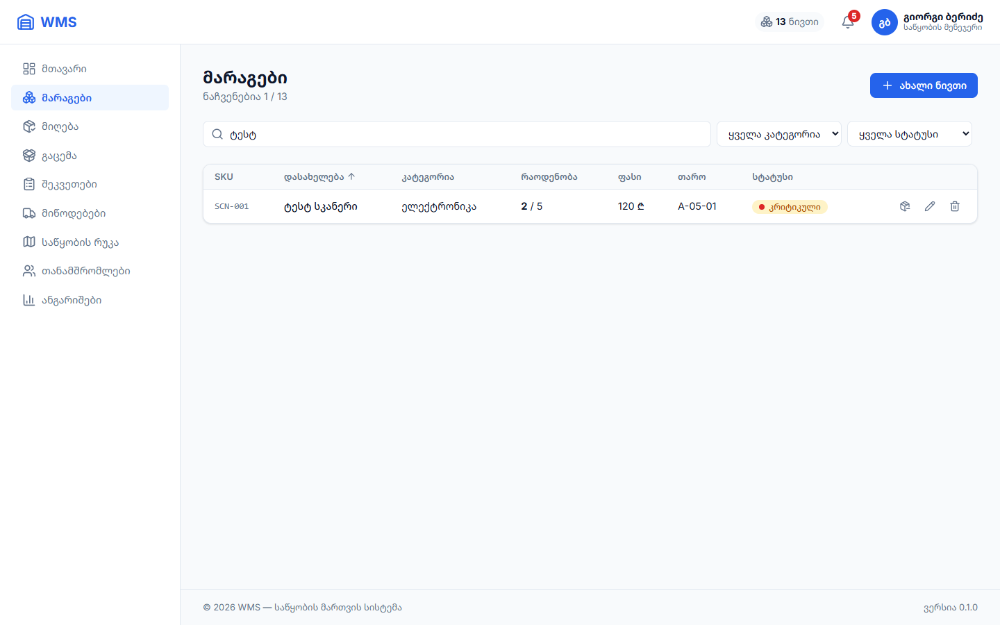

# პრაქტიკული დავალება 19 — სთეით-მენეჯმენტის არქიტექტურა

**პროექტი:** WMS · **არჩეული მიმართულება:** ✅ **ვარიანტი A: React Context API + useReducer + Custom Hook + localStorage**

**რატომ ეს ვარიანტი:**
- ჩაშენებულია React-ში, ამიტომ დამატებითი ბიბლიოთეკა არ სჭირდება;
- ავტორიზაცია (`AuthContext`) უკვე Context-ით მქონდა და მარაგებისთვისაც ამავე მიდგომას ვიყენებ;
- `useReducer` Redux-ის პრინციპზე (action → reducer → state) მუშაობს, ამიტომ მომავალში Redux Toolkit-ზე გადასვლა მარტივი იქნება.

---

## 🔴 პრობლემა: როგორ იყო ადრე

```
DashboardPage ── useItems() ── useState(items)  ── GET /items   ← ცალკე ასლი
InventoryPage ── useItems() ── useState(items)  ── GET /items   ← მეორე ასლი
               └ useInventoryFilters() ── useState(search, category, status, sort)
Header        ── „3" (ხელით ჩაწერილი რიცხვი)
```

- **მონაცემები გაფანტული იყო.** თითო გვერდს თავისი `useState` ჰქონდა. მარაგების გვერდზე დამატებულ ნივთს Dashboard ახალი მოთხოვნის გარეშე ვერ ხედავდა;
- **Header-ს მონაცემებზე წვდომა არ ჰქონდა.** ზარზე რიცხვი „3“ ხელით ეწერა;
- **Refresh-ის შემდეგ ფილტრები იკარგებოდა:** ძებნა, კატეგორია და სორტირება.

## 🟢 გადაწყვეტა: Single Source of Truth

```
                 ┌─────────────────────────────────────────┐
                 │   InventoryProvider (Context + useReducer) │
                 │   state: { items, source, isLoading,       │
                 │            filters: { search, category,    │
                 │                       status, sortKey } }  │
                 │        ⇅ localStorage ('wms-inventory')    │
                 └─────────────────────────────────────────┘
                          ▲ useInventory()  (Custom Hook)
       ┌──────────────────┼──────────────────┬────────────────┐
     Header           DashboardPage      InventoryPage     ItemForm (მოდალი)
  მრიცხველი + ზარი     სტატისტიკა         ცხრილი + ფილტრები   addItem / editItem
```

ყველა კომპონენტი ერთსა და იმავე state-ს კითხულობს `useInventory()`-ით, **props-ის გადაცემის გარეშე**.

---

## 📁 ფაილები

| ფაილი | რას აკეთებს |
|---|---|
| [store/inventory/inventoryReducer.ts](../wms-app/src/store/inventory/inventoryReducer.ts) | State-ის ტიპი, საწყისი მნიშვნელობა, **11 action** და **reducer** (სუფთა ფუნქცია) |
| [store/inventory/InventoryContext.tsx](../wms-app/src/store/inventory/InventoryContext.tsx) | **Provider**: `useReducer`, სერვერთან კავშირი, CRUD ფუნქციები, localStorage-თან სინქრონიზაცია |
| [store/inventory/inventoryStorage.ts](../wms-app/src/store/inventory/inventoryStorage.ts) | localStorage: შენახვა, წაკითხვა, ოფლაინ რეჟიმის მონაცემები |
| [store/inventory/useInventory.ts](../wms-app/src/store/inventory/useInventory.ts) | **Custom Hook-ები** `useInventory()` და `useInventoryCounts()` (სელექტორი Header-ისთვის) |
| [App.tsx](../wms-app/src/App.tsx) | `<InventoryProvider>` ყველა დაცულ გვერდს მოიცავს |

---

## 1️⃣ მონაცემთა კოლექცია: CRUD

### Action-ები

```ts
type InventoryAction =
  | { type: 'LOAD_START' }
  | { type: 'LOAD_SUCCESS'; items: Item[] }
  | { type: 'LOAD_FALLBACK'; items: Item[]; source: 'cache' | 'demo' }
  | { type: 'ADD_ITEM'; item: Item }          // დამატება
  | { type: 'UPDATE_ITEM'; item: Item }       // რედაქტირება / ჩამოწერა
  | { type: 'DELETE_ITEM'; id: number }       // წაშლა
  | { type: 'SET_SEARCH'; search: string }    // ფილტრები
  | { type: 'SET_CATEGORY'; category: string }
  | { type: 'SET_STATUS'; status: ItemStatus | '' }
  | { type: 'TOGGLE_SORT'; sortKey: SortKey }
  | { type: 'RESET_FILTERS' }
```

### Reducer: სუფთა ფუნქცია, state პირდაპირ არ იცვლება

```ts
case 'ADD_ITEM':
  return { ...state, items: [...state.items, action.item] }

case 'UPDATE_ITEM':
  return { ...state, items: state.items.map((i) => (i.id === action.item.id ? action.item : i)) }

case 'DELETE_ITEM':
  return { ...state, items: state.items.filter((i) => i.id !== action.id) }
```

### Dispatch: ჯერ სერვერი, მერე Store

```ts
const addItem = useCallback(async (data: NewItem) => {
  dispatch({ type: 'ADD_ITEM', item: await createItem(data) })   // POST /items → Store
}, [])
```

---

## 2️⃣ კავშირი კომპონენტებს შორის (Prop Drilling-ის გარეშე)

**სცენარი:** მოდალში ვამატებ ახალ ნივთს „ტესტ სკანერი“, თან ძებნის ველში უკვე წერია „ტესტ“.

| რა ხდება | როგორ |
|---|---|
| **1. ცხრილი განახლდა** (0 → 1 რიგი) | `InventoryPage` კითხულობს `state.items`-ს Store-იდან |
| **2. Header-ის მრიცხველი გაიზარდა 1-ით** (12 → 13 ნივთი) | `Header` კითხულობს `useInventoryCounts().total`-ს |
| **3. ზარზე კრიტიკული მარაგი გაიზარდა** (4 → 5) | ახალი ნივთი კრიტიკულია (2 / 5) → `useInventoryCounts().critical` |
| **4. ძებნამ ახალ ნივთზე მაშინვე იმოქმედა** | ფილტრი (`state.filters.search`) Store-შია და იმავე `items`-ზე ითვლება |
| **5. Dashboard-ზე წერია „13 სახეობის ნივთი"** | იგივე Store, სერვერზე ახალი მოთხოვნის გარეშე |

`Header`, `InventoryPage`, `DashboardPage` და `ItemForm` **ერთმანეთს props-ს არ გადასცემენ**: ყველა პირდაპირ Store-ს უკავშირდება.

**დამატებითი ურთიერთქმედება:** 🔔 ზარზე დაჭერა Store-ში ფილტრს „კრიტიკული“-ზე აყენებს (`setStatus('low_stock')`) და მარაგების გვერდზე გადაჰყავს. Header ცვლის state-ს, რომელსაც სხვა გვერდი კითხულობს.

| ნივთის დამატებამდე | დამატების შემდეგ |
|---|---|
|  |  |

---

## 3️⃣ სინქრონიზაცია localStorage-თან (Persistence)

```ts
// 1. საწყისი state — localStorage-დან (lazy initializer: იკითხება მხოლოდ ერთხელ)
const [state, dispatch] = useReducer(inventoryReducer, undefined, loadInitialState)

// 2. ყოველი ცვლილება ავტომატურად ინახება
useEffect(() => {
  if (!state.isLoading) saveInventory(state)
}, [state])
```

**რა ინახება** (`localStorage['wms-inventory']`):
```json
{ "items": [ ... 13 ნივთი ... ],
  "filters": { "search": "ტესტ", "category": "", "status": "", "sortKey": "name", "sortAsc": true },
  "savedAt": "2026-10-27T..." }
```

| Refresh-ის შემდეგ | შედეგი |
|---|---|
| დამატებული ნივთი | ✅ რჩება (13 ნივთი) |
| ძებნის ველი „ტესტ“ | ✅ რჩება |
| კატეგორია, სტატუსი, სორტირება | ✅ რჩება |
| ჩატვირთვა | ✅ მონაცემები **მაშინვე** ჩანს localStorage-დან, Skeleton-ის გარეშე. სერვერიდან განახლება ფონურად მოდის |
| სერვერი გათიშულია | ✅ ჩანს ბოლოს შენახული მონაცემები ბანერით (მე-15 დავალება) |



**დაცვა:** localStorage-ის ყველა წაკითხვა და ჩაწერა `try/catch`-შია. თუ ბრაუზერში შენახვა გამორთულია ან მონაცემი დაზიანებულია, აპი მაინც მუშაობს.

---

## 🧪 შემოწმება (ავტომატური ტესტი, Chrome)

| # | ნაბიჯი | შედეგი |
|---|---|---|
| 1 | საწყისი მდგომარეობა | Header: **12**, ზარი: **4**, ცხრილი: 12 |
| 2 | ძებნა „ტესტ“ | 0 რიგი |
| 3 | მოდალით დამატება „ტესტ სკანერი“ | Header: **13** ✅, ზარი: **5** ✅, ცხრილი: **1** (ძებნამ რეაგირება მოახდინა) ✅ |
| 4 | localStorage | 13 ნივთი, `filters.search = "ტესტ"` ✅ |
| 5 | გვერდის Refresh | Header: 13, ძებნის ველი: „ტესტ“, ცხრილი: 1 ✅ |
| 6 | Dashboard | „13 სახეობის ნივთი“ ✅ |
| 7 | ზარზე დაჭერა | `/inventory`, სტატუსი „კრიტიკული“ ✅ |
| 8 | წაშლა | Header: 12 ✅ |

ტესტისას ერთი ხარვეზიც ვიპოვე: 320px ეკრანზე Header-ის ახალი მრიცხველი ავატარს ეკრანიდან 8px-ით გაწევდა. გასწორდა: ≤400px-ზე მხოლოდ რიცხვი ჩანს.

---

## Git commit-ები

```
feat: add inventory reducer and localStorage persistence helpers
feat: add InventoryProvider with useReducer as single source of truth
refactor: move items and filters from local state to global inventory store
feat: show live item count and critical stock badge in header
fix: fit header counter on 320px screens
```
