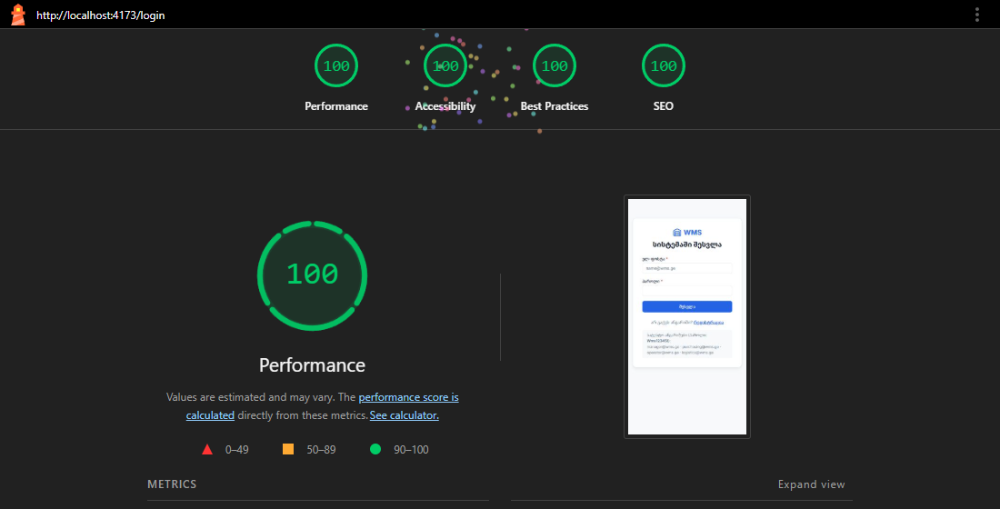

# WMS — საწყობის მართვის სისტემა — ფინალური ტექნიკური ანგარიში

**მოდული:** პრაქტიკული პროექტი (Front-end პროგრამირება — 06.1.1.9)
**სტუდენტი / გუნდი:** [სახელი, გვარი] — ინდივიდუალური
**GitHub რეპოზიტორია:** https://github.com/Iobis21/finally-project
**Live Demo:** ჯერ არ არის განთავსებული. ლოკალურად ეშვება ბრძანებით `npm install` → `npm run dev` (იხ. [README](../README.md))

---

### 1. პროექტის რეზიუმე და ამოცანა

* **მიზანი:** WMS არის საწყობის მართვის ვებ-აპლიკაცია ოთხი როლით: საწყობის მენეჯერი, შესყიდვების მენეჯერი, ოპერატორი და ლოჯისტიკა. თითოეულს მხოლოდ თავისი სამუშაო სივრცე უჩანს. სისტემა მარაგებს რეალურ დროში აჩვენებს, კრიტიკულ ნაშთს ავტომატურად ნიშნავს და საქონლის ჩამოწერას უარყოფითი ნაშთისგან იცავს. ამით ქაღალდისა და Excel-ის აღრიცხვას ცვლის, სადაც საქონელი იკარგება ან მოულოდნელად მთავრდება.

* **ტექნოლოგიური სტეკი:**

| სფერო | ტექნოლოგია |
|---|---|
| UI | React 19, TypeScript, Vite |
| სტილები | Tailwind CSS v4 + კომპონენტური CSS (BEM), CSS ცვლადები (Design Tokens) |
| მარშრუტიზაცია | React Router (Lazy Loading, ProtectedRoute, RoleRoute) |
| სთეით-მენეჯმენტი | **Context API + useReducer** (გლობალური Store) + localStorage |
| ფორმები | React Hook Form + Zod |
| იკონები | Lucide React (SVG) |
| Backend (Mock) | json-server + json-server-auth (JWT, bcrypt) |
| ხარისხი | Prettier, Oxlint, TypeScript strict, Lighthouse, puppeteer (ავტოტესტები) |

* **მთავარი ფუნქციონალი:**
  - შესვლა და რეგისტრაცია;
  - როლები და უფლებები (RBAC), თანამშრომლების მართვა;
  - მარაგები: ძებნა, ფილტრი, სორტირება, დამატება, რედაქტირება, წაშლა და ჩამოწერა მოდალში;
  - კრიტიკული მარაგის ინდიკატორი;
  - ოფლაინ რეჟიმი;
  - რესპონსივი 320px-დან 1440px-მდე.

---

### 2. არქიტექტურა და კომპონენტური იერარქია

* **საქაღალდეების სტრუქტურა:**

```
wms-app/src/
├── components/   UI კომპონენტები (Header, Sidebar, Modal, Button, ErrorBoundary, ItemForm ...)
├── pages/        გვერდები (auth, dashboard, inventory, users, errors)
├── store/        გლობალური Store — InventoryContext + useReducer + localStorage
├── hooks/        ლოგიკა: useItems, useInventoryFilters, useDebounce, useEventDelegation, useUsers
├── services/     API ფენა: apiClient (fetch + JWT), itemService, authService, userService
├── context/      AuthContext (სესია, უფლებები)
├── config/       როლები და უფლებები (ერთი წყარო)
├── routes/       ProtectedRoute, GuestRoute, RoleRoute
├── schemas/      Zod ვალიდაცია
├── types/        TypeScript ინტერფეისები
└── utils/        სუფთა ფუნქციები (სტატუსი, ფასი, სორტირება)
```

ფენები მკაცრად გამიჯნულია: **კომპონენტი → hook → service → API**. კომპონენტებში არცერთი `fetch` არ არის (SOLID: Dependency Inversion). დიდი გვერდები დაყოფილია ერთი პასუხისმგებლობის მქონე პატარა კომპონენტებად (SRP).

**იერარქია (მარაგების გვერდი):**

```
App
└─ ProtectedRoute
   └─ InventoryProvider            ← გლობალური Store
      └─ Layout (CSS Grid)
         ├─ Header                 ← მრიცხველი + კრიტიკული მარაგის ზარი (Store-იდან)
         ├─ Sidebar                ← მენიუ როლის მიხედვით
         └─ ErrorBoundary
            └─ InventoryPage (Container)
               ├─ OfflineBanner
               ├─ InventoryFilters          (Presentational, memo)
               ├─ InventoryTable → InventoryRow (memo) → RowActions   ← Event Delegation
               ├─ InventoryCards → InventoryCard (memo)               ← მობილური
               └─ Modal (createPortal) → ItemForm / WriteOffForm / ConfirmDialog
```

* **გლობალური სთეითი და მეხსიერება:**
  - მარაგების მთელი state ერთ ადგილას ინახება (**Single Source of Truth**): `{ items, source, isLoading, filters }`, მართავს `useReducer` და 11 action (`ADD_ITEM`, `UPDATE_ITEM`, `DELETE_ITEM`, `SET_SEARCH` ...);
  - Header, Dashboard, მარაგები და მოდალი ერთსა და იმავე მონაცემებს `useInventory()`-ით კითხულობენ, **Prop Drilling-ის გარეშე**. მოდალში ნივთის დამატებისას Header-ის მრიცხველი მაშინვე იზრდება;
  - **localStorage:** საწყისი state აქედან იკითხება (`useReducer(reducer, undefined, loadInitialState)`), ყოველი ცვლილება კი `useEffect`-ით ინახება `wms-inventory` გასაღებით. Refresh-ის შემდეგ რჩება ნივთებიც და ფილტრებიც, მონაცემები კი მაშინვე ჩანს, Skeleton-ის გარეშე;
  - სესია (JWT ტოკენი და მომხმარებელი) ცალკე `AuthContext`-შია და ისიც localStorage-ში ინახება.

---

### 3. ტექნიკური გამოწვევები და გადაწყვეტები (2 ქეისი)

#### ქეისი 1: ქართული სორტირება ბრაუზერებში განსხვავდებოდა

**პრობლემა:** კროს-ბრაუზერული ტესტირებისას აღმოჩნდა, რომ დასახელებით დალაგებისას Chrome-ში სიის თავში „A4 ქაღალდი“ იყო, Edge-ში კი ბოლოში. დიაგნოსტიკამ აჩვენა, რომ `new Intl.Collator('ka')` Chrome-ში აბრუნებს **`en-GB`**-ს, რადგან ქართული ენის წესები არ აქვს, Edge-ში კი **`ka`**-ს. ამიტომ `localeCompare(b, 'ka')`-ის შედეგი ბრაუზერზე იყო დამოკიდებული.

➔ **გადაწყვეტა:** ბრაუზერისგან დამოუკიდებელი ფუნქცია, რომელშიც ჯერ ქართული სახელები მოდის ანბანის მიხედვით, შემდეგ დანარჩენი. მხედრული Unicode-ში ანბანის რიგითაა.

```ts
const GEORGIAN = /^[ა-ჿ]/

export function compareNames(a: string, b: string) {
  const aGeorgian = GEORGIAN.test(a)
  const bGeorgian = GEORGIAN.test(b)
  if (aGeorgian !== bGeorgian) return aGeorgian ? -1 : 1
  return a.localeCompare(b, 'en', { numeric: true, sensitivity: 'base' })
}
```

**შედეგი:** Chrome-ში, Edge-სა და Firefox-ში სია ზუსტად ერთნაირად ლაგდება.

#### ქეისი 2: Race Condition: ძველი პასუხი ახალს გადაფარავდა

**პრობლემა:** კონსოლში ჩნდებოდა `Timer 'items:load' already exists`. DevTools-ის breakpoint-მა აჩვენა, რომ `load()` ერთდროულად ორჯერ ეშვებოდა: React StrictMode `useEffect`-ს ორჯერ უშვებს, ხოლო „ხელახლა ცდა“ ახალ მოთხოვნას აგზავნის. ორ პარალელურ მოთხოვნას შორის **ნელი, ძველი პასუხი შეიძლებოდა ბოლოს მოსულიყო და ახალი მონაცემები გადაეფარა**. იგივე საფრთხე იყო ჩამოწერაზე: ორ ოპერატორს შეეძლო ერთი და იგივე ნაშთის ერთდროულად ჩამოწერა.

➔ **გადაწყვეტა:**
1. ყოველ ჩატვირთვას თავისი ნომერი აქვს და პასუხი მიიღება, მხოლოდ თუ ის ბოლოა;
2. ჩამოწერამდე სერვერიდან **უახლესი** ნაშთი მოწმდება.

```ts
const requestId = ++requestIdRef.current
const items = await getItems()
if (requestId !== requestIdRef.current) return // უფრო ახალი მოთხოვნა უკვე გაიგზავნა
dispatch({ type: 'LOAD_SUCCESS', items })
```

```ts
const fresh = await getItem(id)                  // უახლესი ნაშთი სერვერიდან
if (amount > fresh.quantity) throw new Error(`ნაშთი შეიცვალა — ახლა მხოლოდ ${fresh.quantity} ერთეულია`)
```

ამას ავსებს **Fail-Fast Zod** ვალიდაცია ფრონტენდზე (`.max(stock)`) და ღილაკის ბლოკი გაგზავნისას (disabled + „ინახება...“).

> სულ დოკუმენტირებულია 5+ რეალური ბაგი: Vite-ის მიერ გვერდის გადატვირთვა db.json-ის ცვლილებისას, ErrorBoundary და React 19-ის render retry, Badge-ების კონტრასტი 2.86:1, ცხრილის გაჭრა პლანშეტზე. დეტალები: [დავალება 15](../პრაქტიკული%20დავალება%2015/DAVALEBA_15.md), [დავალება 18](../პრაქტიკული%20დავალება%2018/TESTING.md).

---

### 4. წარმადობა, ოპტიმიზაცია და ტესტირება

* **Lighthouse ქულები** (production build, `vite preview`):

| გვერდი | მოწყობილობა | Performance | Accessibility | Best Practices | SEO |
|---|---|:---:|:---:|:---:|:---:|
| შესვლა | 📱 მობილური | **100** | **100** | **100** | **100** |
| შესვლა | 🖥️ დესკტოპი | **95** | **100** | **100** | **100** |
| მთავარი (Dashboard) | 📱 მობილური | **98** | **100** | **100** | **100** |
| მთავარი (Dashboard) | 🖥️ დესკტოპი | **95** | **100** | **100** | **100** |
| მარაგები | 📱 მობილური | **99** | **100** | **100** | **100** |
| მარაგები | 🖥️ დესკტოპი | **95** | **100** | **100** | **100** |



**Lighthouse-მა რა იპოვა და როგორ გასწორდა:**

| პრობლემა | იყო | გასწორება | გახდა |
|---|---|---|---|
| `meta-description` არ არის | SEO 82 | `<meta name="description">` | SEO **100** |
| `robots.txt` არ არის | SEO 82 | `public/robots.txt` | SEO **100** |
| ბმული ტექსტისგან მხოლოდ ფერით განსხვავდება | A11y 95 | ქვედა ხაზი (`text-decoration: underline`) | A11y **100** |
| `aria-label` ხილულ ტექსტს არ ემთხვევა (პროფილი) | A11y | ზედმეტი `aria-label` ამოღებულია | ✅ |
| CLS: შესვლის ბარათი ვებ-ფონტის ჩატვირთვისას „ხტება“ | CLS **0.168**, Perf 93 | ბარათი ზედა კიდესთან და არა ცენტრში | CLS **0.017**, Perf **100** |

სრული ანგარიშები: [lighthouse/](lighthouse/) (HTML ფაილები, ბრაუზერში გაიხსნება).

* **მედია ოპტიმიზაცია:** 1600×1200 PNG → 480×360 **WebP** (ხარისხი 75), `loading="lazy"`, `width`/`height` (CLS-ისგან დაცვა):

| სურათი | PNG | WebP | შემცირება |
|---|---:|---:|---:|
| electronics | 2 008 KB | 1.9 KB | 99.9% |
| furniture | 2 311 KB | 2.0 KB | 99.9% |
| stationery | 2 102 KB | 2.5 KB | 99.9% |
| packaging | 2 091 KB | 2.5 KB | 99.9% |
| **სულ** | **8.3 MB** | **8.9 KB** | **~960×** |

ყველა იკონა SVG-ია (Lucide React).

* **კოდის ოპტიმიზაცია:**

| ტექნიკა | შედეგი |
|---|---|
| `React.lazy` + `Suspense` (Code Splitting) | მთავარი JS **429 kB → 267 kB** (−38%), 12 ცალკე chunk |
| `React.memo` + `useCallback` | ცხრილის 12 რიგი ზედმეტად აღარ იხატება, რედაქტირებისას იხატება მხოლოდ 1 |
| `useMemo` | ფილტრაცია და სტატისტიკა ითვლება მხოლოდ მონაცემების შეცვლისას |
| Debounce (300ms) | ძებნა ერთხელ, ყოველ ასოზე ძებნის ნაცვლად |
| Event Delegation | 1 მსმენელი ცხრილზე, 24-ის ნაცვლად |
| ანიმაციები მხოლოდ `transform` / `opacity` | GPU, Layout Thrashing-ის გარეშე |

* **სტაბილურობა:**

| მექანიზმი | როგორ მუშაობს |
|---|---|
| **ErrorBoundary** | Runtime შეცდომისას თეთრი ეკრანის ნაცვლად ჩანს Fallback და „სცადეთ ხელახლა“. Header და მენიუ აგრძელებს მუშაობას |
| **Offline fallback** | სერვერის 500-ისას ან ინტერნეტის გაწყვეტისას ჩანს localStorage-ის ან დემო მონაცემები და ბანერი „⚠ ნაჩვენებია ლოკალური მონაცემები“. ცვლილების ღილაკები იმალება |
| **Double-Click** | ღილაკი გაგზავნისას disabled-ია |
| **უარყოფითი ნაშთი** | Zod `.max(stock)` + სერვერზე უახლესი ნაშთის შემოწმება |

* **ტესტირება:**
  - **კროს-ბრაუზერული:** Chrome, Edge და Firefox × 6 მოწყობილობა (320–1440px) × 5 გვერდი = **90 კომბინაცია**, ჰორიზონტალური სქროლისა და შეცდომების გარეშე;
  - **ავტომატური E2E ტესტები** (puppeteer):
    - შესვლა, რეგისტრაცია და როლები;
    - CRUD და ვალიდაცია;
    - Store-ის სინქრონიზაცია და Refresh;
    - ErrorBoundary და ოფლაინ რეჟიმი.

---

### 5. დასკვნა და სამომავლო გეგმა (Roadmap)

* **რა ვისწავლე / რა გავაუმჯობესე:**
  - **დაგეგმვა კოდამდე:** ტექნიკური დავალება, User Flow, ვაიერფრეიმები და Story Points-ები;
  - **React არქიტექტურა:** კომპონენტების დაყოფა (SOLID, DRY), Custom Hooks, სერვისების ფენა;
  - **სთეით-მენეჯმენტი:** Context + useReducer, ერთი Store და localStorage persistence;
  - **ფორმები და ვალიდაცია:** React Hook Form + Zod, Fail-Fast;
  - **ავტორიზაცია და RBAC:** JWT, დაცული მარშრუტები, უფლებების ერთი წყარო;
  - **მდგრადობა:** ErrorBoundary, ოფლაინ რეჟიმი, Race Condition-ის დაცვა;
  - **წარმადობა:** memo, lazy loading, WebP, Lighthouse 95–100;
  - **ხელმისაწვდომობა:** კლავიატურა, `:focus-visible`, კონტრასტი WCAG AA;
  - **დებაგინგი:** DevTools (breakpoint, Network, console.table/time), კროს-ბრაუზერული ტესტირება;
  - **Git:** Conventional Commits, 60+ ატომური commit.

* **პროექტის შემდეგი ნაბიჯები (v2.0):**

| პრიორიტეტი | ფუნქცია |
|:---:|---|
| 🔴 | **Live Demo:** ფრონტენდი Vercel-ზე, ბექენდი Render-ზე (ან Supabase-ზე გადატანა) |
| 🔴 | **საქონლის მიღება** შტრიხკოდის სკანირებით (Inbound) და **გაცემა** (Picking / Packing) |
| 🔴 | **შესყიდვის შეკვეთები** (PO): შექმნა → დამტკიცება → მიღება |
| 🟠 | მიწოდებები და კურიერების სტატუსები რეალურ დროში |
| 🟠 | საწყობის ვიზუალური რუკა (ზონები, თაროები, დატვირთვა) |
| 🟠 | ანგარიშები და გრაფიკები (Recharts), ექსპორტი CSV / PDF |
| 🟢 | შეტყობინებების ცენტრი, მუქი თემა (ცვლადები უკვე მზადაა), აუდიტის ჟურნალი |
| 🟢 | Unit ტესტები (Vitest) reducer-ისა და utils-ისთვის, CI GitHub Actions-ით |
