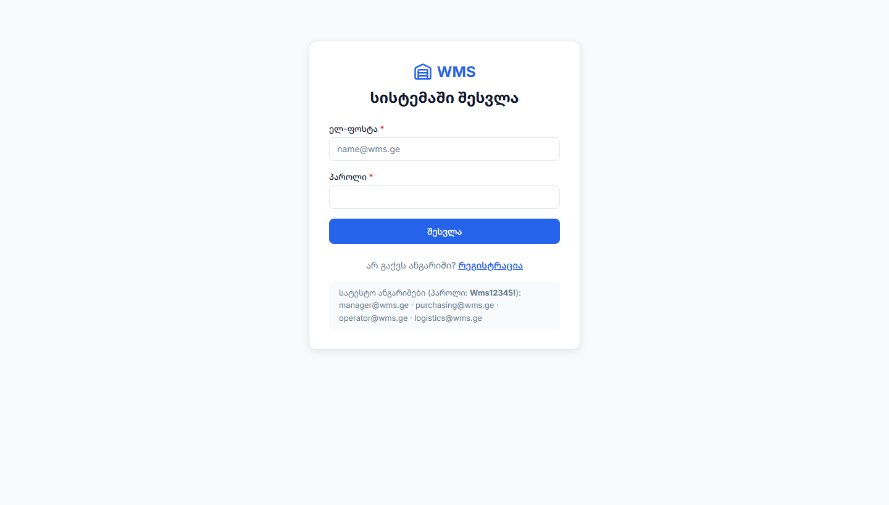
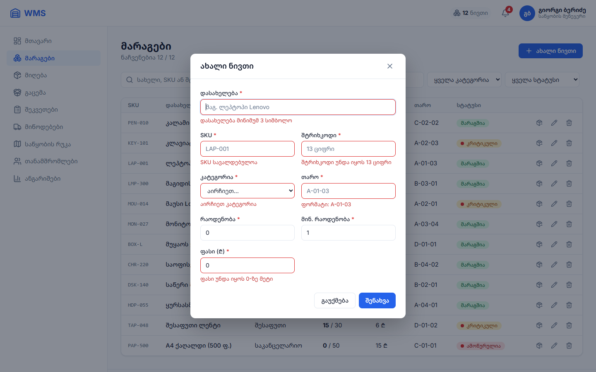
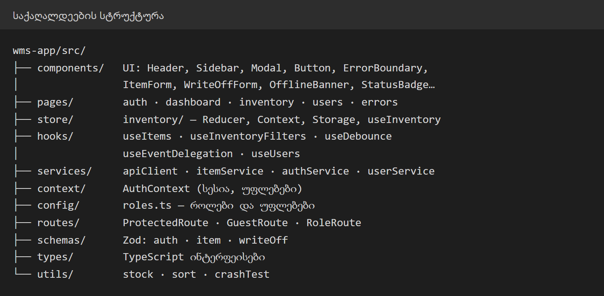
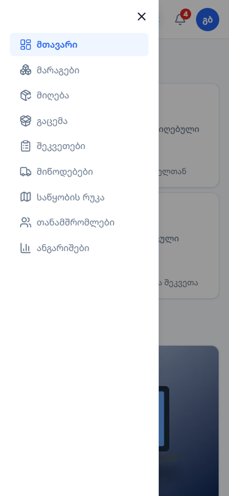
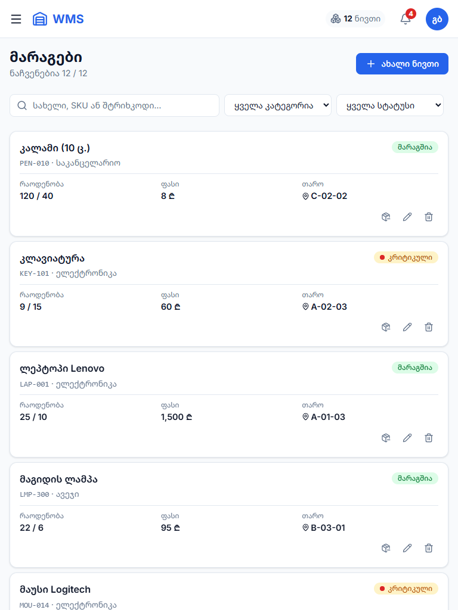

# პროექტის არსი და ტექნიკური ანალიტიკა

**საბოლოო გამოცდის დოკუმენტაცია**

- **სტუდენტი:** იობი შარაშენიძე
- **პროექტი:** WMS, როლებზე დაფუძნებული საწყობის მართვის სისტემა
- **GitHub:** https://github.com/Iobis21/finally-project
- **Live Demo:** https://finally-project-3lf1.vercel.app (Vercel)

---

## 1. პროექტის არსი და ბიზნეს-კონცეფცია

**პროექტის მიზანი და გადაჭრილი პრობლემა.** მცირე და საშუალო საწყობებში მარაგი ხშირად ქაღალდის ჟურნალში ან Excel-ში აღირიცხება. ამის გამო საქონელი იკარგება, ნაშთი არ ემთხვევა რეალობას და პროდუქტი მოულოდნელად მთავრდება, რადგან დროულად არავინ შეუკვეთა. გარდა ამისა, ყველა თანამშრომელს ყველაფერზე აქვს წვდომა: ოპერატორს შეუძლია შემთხვევით ფასი ან ნაშთი შეცვალოს. **WMS** ამ პროცესს ერთ ვებ-სისტემაში აერთიანებს: მარაგი ჩანს რეალურ დროში, კრიტიკული ნაშთი ავტომატურად ინიშნება, ჩამოწერა უარყოფითი ნაშთისგან დაცულია, თითოეული თანამშრომელი კი მხოლოდ თავის სამუშაო სივრცეს ხედავს.

**სამიზნე მომხმარებლები (User Personas):**

| პერსონა | როლი | მთავარი მიზანი სისტემაში შესვლისას |
|---|---|---|
| 🧑‍💼 გიორგი, 38 | საწყობის მენეჯერი | საწყობის მდგომარეობის მთლიანად დანახვა, ასორტიმენტის მართვა (დამატება, რედაქტირება, წაშლა), თანამშრომლებისთვის როლების განაწილება |
| 🛒 ნინო, 31 | შესყიდვების მენეჯერი | კრიტიკული მარაგის დროულად შემჩნევა, რომ საქონელი შეუკვეთოს მანამ, სანამ ამოიწურება |
| 👷 ნიკა, 24 | ოპერატორი (პლანშეტით საწყობში) | ნივთის სწრაფი პოვნა თაროზე, დაზიანებული ან დაკარგული საქონლის ჩამოწერა |
| 🚚 ლევანი, 35 | ლოჯისტიკის თანამშრომელი | გასაცემი საქონლისა და მიწოდებების კონტროლი |

---

## 2. მომხმარებლის ნაკადისა და ფუნქციონალის ანალიტიკა

**მომხმარებლის მთავარი გზა (Happy Path): საწყობის მენეჯერი ამატებს ახალ ნივთს**

1. **შესვლა:** ელ-ფოსტა და პაროლი, სერვერი აბრუნებს JWT ტოკენს. როლის მიხედვით იხსნება შესაბამისი მენიუ;
2. **მთავარი გვერდი:** სტატისტიკის 4 ბარათი. 🔔 ზარზე ჩანს კრიტიკული მარაგის რაოდენობა;
3. **მარაგები:** ძებნა სახელით, SKU-ით ან შტრიხკოდით (Debounce 300ms), ფილტრი კატეგორიით და სტატუსით, სორტირება;
4. **მოდალი:** „+ ახალი ნივთი“ ხსნის ფორმას მოდალურ ფანჯარაში (createPortal);
5. **ვალიდაცია:** Zod ფორმას გაგზავნამდე ამოწმებს (SKU-ს ფორმატი, 13-ციფრიანი შტრიხკოდი, თაროს მისამართი). შეცდომა ჩანს ველის ქვეშ, გაგზავნისას კი ღილაკი იბლოკება;
6. **შენახვა:** მონაცემი ჯერ სერვერზე (`POST /items`), შემდეგ გლობალურ Store-ში ინახება. ცხრილი, Header-ის მრიცხველი (+1) და localStorage მაშინვე ახლდება, **Refresh-ის გარეშე**.

**ძირითადი ინტერაქციული შესაძლებლობები (CRUD):**

| ოპერაცია | რა | ვის შეუძლია |
|---|---|---|
| **Create** | ახალი ნივთი (მოდალი + ვალიდაცია), რეგისტრაცია | მენეჯერი; რეგისტრაცია — ყველას |
| **Read** | მარაგების ცხრილი/ბარათები, ძებნა, ფილტრი, სორტირება, სტატისტიკა | ყველა როლი |
| **Update** | ნივთის რედაქტირება, **ჩამოწერა** (ნაშთზე მეტი არა), თანამშრომლის როლის შეცვლა / დაბლოკვა | მენეჯერი; ჩამოწერა — მენეჯერი და ოპერატორი |
| **Delete** | ნივთის წაშლა დადასტურებით | მენეჯერი |

---

## 3. ტექნიკური არქიტექტურა და მონაცემთა მართვა

**ტექნოლოგიური სტეკი და არჩევის მიზეზი:**

| ტექნოლოგია | რატომ |
|---|---|
| **React 19** | კომპონენტური მიდგომა: UI იწყობა პატარა, მრავალჯერადი ნაწილებისგან |
| **TypeScript** | ბევრი ტიპის მონაცემია (ნივთი, მომხმარებელი, როლი, შეკვეთა). ტიპები შეცდომას კოდის გაშვებამდე იჭერს |
| **Vite** | სწრაფი dev სერვერი და build, Code Splitting |
| **Tailwind CSS v4 + BEM CSS** | დიზაინ-ტოკენები (`@theme`, `:root`) ერთ ადგილას. ლეიაუთი იწყობა CSS Grid-ით და Flexbox-ით |
| **React Router** | მარშრუტები, Lazy Loading, დაცული გვერდები (ProtectedRoute, RoleRoute) |
| **Context API + useReducer** | გლობალური Store დამატებითი ბიბლიოთეკის გარეშე. action → reducer → state პრინციპი (Redux-ის მსგავსი) |
| **React Hook Form + Zod** | სწრაფი ფორმები ზედმეტი რენდერის გარეშე. ვალიდაციის წესები ქართული შეცდომებით, ტიპები ავტომატურად |
| **json-server + json-server-auth** | REST API და JWT ავტორიზაცია. პაროლები bcrypt-ით იშიფრება |
| **Lucide React** | SVG იკონები: მსუბუქი და მკვეთრი ნებისმიერ ზომაზე |

**საქაღალდეების სტრუქტურა:**

ფენები მკაცრად გამიჯნულია: **კომპონენტი → hook / store → service → API**. კომპონენტებში არცერთი `fetch` არ არის (SOLID: Dependency Inversion). თითო ფაილს ერთი პასუხისმგებლობა აქვს (SRP).

**სთეითის სინქრონიზაცია:**

- **Single Source of Truth:** მარაგების მთელი state (`items`, `filters`, `source`) ერთ `InventoryContext`-შია. მას მართავს `useReducer` და 11 action (`ADD_ITEM`, `UPDATE_ITEM`, `DELETE_ITEM`, `SET_SEARCH` ...);
- **Prop Drilling-ის გარეშე:** Header, Dashboard, მარაგების გვერდი და მოდალი ერთსა და იმავე მონაცემს `useInventory()`-ით კითხულობენ. მოდალში დამატებული ნივთი Header-ის მრიცხველს მაშინვე ზრდის;
- **localStorage:** საწყისი state აქედან იკითხება, ყოველი ცვლილება კი ავტომატურად ინახება (`wms-inventory`). Refresh-ის შემდეგ რჩება ნივთებიც და ფილტრებიც, მონაცემები კი მაშინვე ჩანს. სესია (JWT) ცალკე ინახება (`wms-token`);
- **მონაცემთა ბაზა:** `db.json` (json-server). ყველა CRUD ოპერაცია ჯერ აქ ინახება, შემდეგ Store-ში.

---

## 4. წარმადობის, ვალიდაციისა და მდგრადობის ანალიტიკა

**ოპტიმიზაცია:**

| ტექნიკა | შედეგი |
|---|---|
| **useDebounce** (300ms) | ძებნა იწყება ბეჭდვის შეწყვეტის შემდეგ და არა ყოველ ასოზე |
| **useMemo** | ფილტრაცია, სორტირება და სტატისტიკა ხელახლა ითვლება მხოლოდ მონაცემის შეცვლისას |
| **React.memo + useCallback** | ცხრილის რიგები ზედმეტად აღარ იხატება. რედაქტირებისას იხატება მხოლოდ 1 რიგი |
| **React.lazy + Suspense** | მთავარი JS **429 kB → 267 kB** (−38%), გვერდები იტვირთება საჭიროებისამებრ |
| **WebP + loading="lazy"** | სურათები **8.3 MB (PNG) → 8.9 KB (WebP)** |
| **Event Delegation** | 1 მსმენელი ცხრილზე, 24-ის ნაცვლად |
| **GPU ანიმაციები** | მხოლოდ `transform` / `opacity` |
| **Lighthouse** | Performance **95–100**, Accessibility, Best Practices და SEO **100** |

**დაცვითი მექანიზმები (Defensive Programming):**

| საფრთხე | დაცვა |
|---|---|
| კომპონენტის Runtime შეცდომა (თეთრი ეკრანი) | **ErrorBoundary**: Fallback და „სცადეთ ხელახლა“. Header და მენიუ მუშაობს |
| სერვერის გათიშვა / ინტერნეტის გაწყვეტა | **ოფლაინ რეჟიმი**: localStorage-ის ან დემო მონაცემები და ბანერი „⚠ ნაჩვენებია ლოკალური მონაცემები“ |
| არასწორი მონაცემი ფორმაში | **Zod (Fail-Fast)**: ფორმა სერვერზე არ იგზავნება |
| ორმაგი დაჭერა (Double-Click) | ღილაკი disabled-ია და წერია „ინახება...“ |
| ნაშთზე მეტის ჩამოწერა / ორი თანამშრომელი ერთდროულად | Zod `.max(stock)` + ჩაწერამდე სერვერიდან **უახლესი** ნაშთის შემოწმება |
| ძველი სერვერის პასუხი ახალს გადაფარავს (Race Condition) | ყოველ მოთხოვნას ნომერი აქვს. მიიღება მხოლოდ ბოლო პასუხი |
| უფლების გარეშე წვდომა | **ProtectedRoute** (JWT) + **RoleRoute** (403) + ღილაკების დამალვა როლის მიხედვით |

| ErrorBoundary | ოფლაინ რეჟიმი |
|---|---|
|  |  |

**რესპონსიულობა:**

| ეკრანი | რა იცვლება |
|---|---|
| 🖥️ **დესკტოპი, 1440px** | CSS Grid: Sidebar (260px) + შიგთავსი. ცხრილი 8 სვეტით, 4 სტატისტიკის ბარათი ერთ ხაზზე |
| 📱 **პლანშეტი, 768px** | Sidebar იმალება (☰), ფილტრები ერთ ხაზზე, ცხრილი ბარათებად |
| 📱 **მობილური, 375px** | ერთსვეტიანი ბადე, ჰამბურგერ მენიუ, ბარათები, 2×2 სტატისტიკა, მოდალი მთელ ეკრანზე |

ტესტირება: Chrome, Edge და Firefox × 6 მოწყობილობა (320–1440px) = 90 კომბინაცია, ჰორიზონტალური სქროლის გარეშე.

| მობილური, 375px | მენიუ | პლანშეტი, 768px |
|---|---|---|
|  |  |  |

---

## 5. დასკვნა და სამომავლო განვითარების გეგმა

**გადაჭრილი მთავარი ტექნიკური გამოწვევა.** ყველაზე რთული აღმოჩნდა მონაცემების **თანმიმდევრულობა** მრავალ კომპონენტსა და ბრაუზერში. თავიდან თითო გვერდი თავის `useState`-ს ინახავდა და სერვერს ცალ-ცალკე ეკითხებოდა, ამიტომ ერთ გვერდზე დამატებული ნივთი მეორეზე არ ჩანდა. ეს გადაწყდა **გლობალური Store-ით** (Context + useReducer) და localStorage-თან სინქრონიზაციით. პარალელური მოთხოვნების „შეჯიბრი“ (Race Condition) მოგვარდა მოთხოვნების ნომრებითა და ჩაწერამდე უახლესი ნაშთის შემოწმებით. კროს-ბრაუზერულმა ტესტმა კი აჩვენა, რომ ქართული სორტირება Chrome-სა და Edge-ში განსხვავდება, რადგან Chrome-ს ქართული ენის წესები არ აქვს. ამისთვის დაიწერა ბრაუზერისგან დამოუკიდებელი `compareNames()`.

**პროექტის განვითარების პერსპექტივა (Version 2.0):**

| პრიორიტეტი | ფუნქცია |
|:---:|---|
| 🔴 | **მუდმივი ბაზა:** Supabase / PostgreSQL ონლაინ ვერსიისთვის |
| 🔴 | **საქონლის მიღება** შტრიხკოდის სკანირებით და **გაცემა** (Picking / Packing) |
| 🔴 | **შესყიდვის შეკვეთები:** შექმნა → მენეჯერის დამტკიცება → მიღება |
| 🟠 | მიწოდებები და კურიერების სტატუსები რეალურ დროში |
| 🟠 | საწყობის ვიზუალური რუკა (ზონები, თაროები, დატვირთვა) |
| 🟠 | ანგარიშები და გრაფიკები, CSV / PDF ექსპორტი |
| 🟢 | შეტყობინებების ცენტრი, მუქი თემა, აუდიტის ჟურნალი |
| 🟢 | Unit ტესტები (Vitest) და CI (GitHub Actions) |
