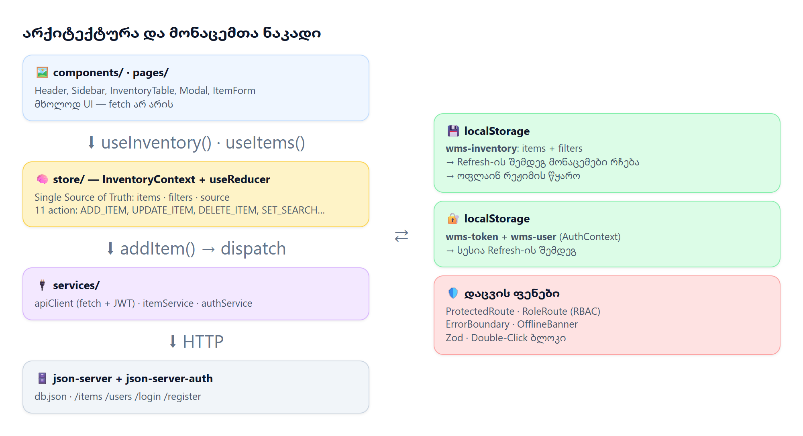
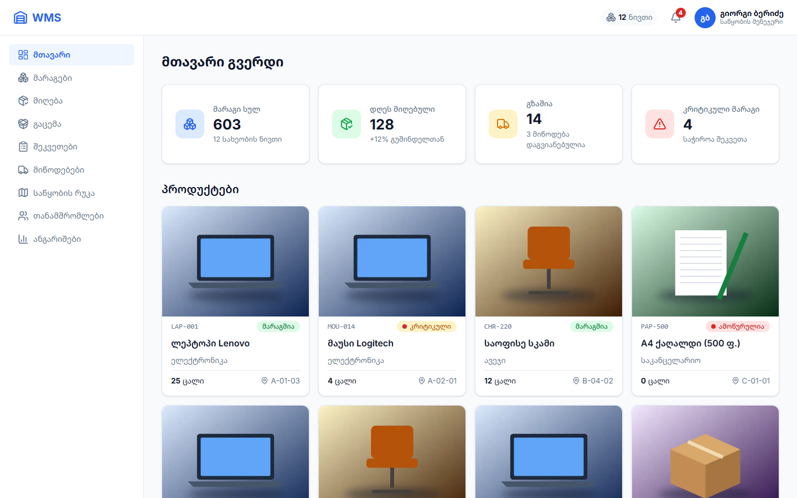
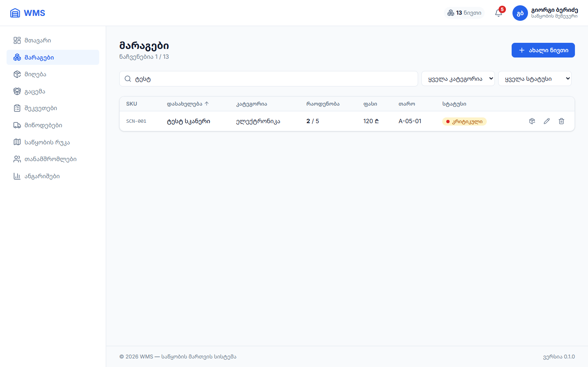
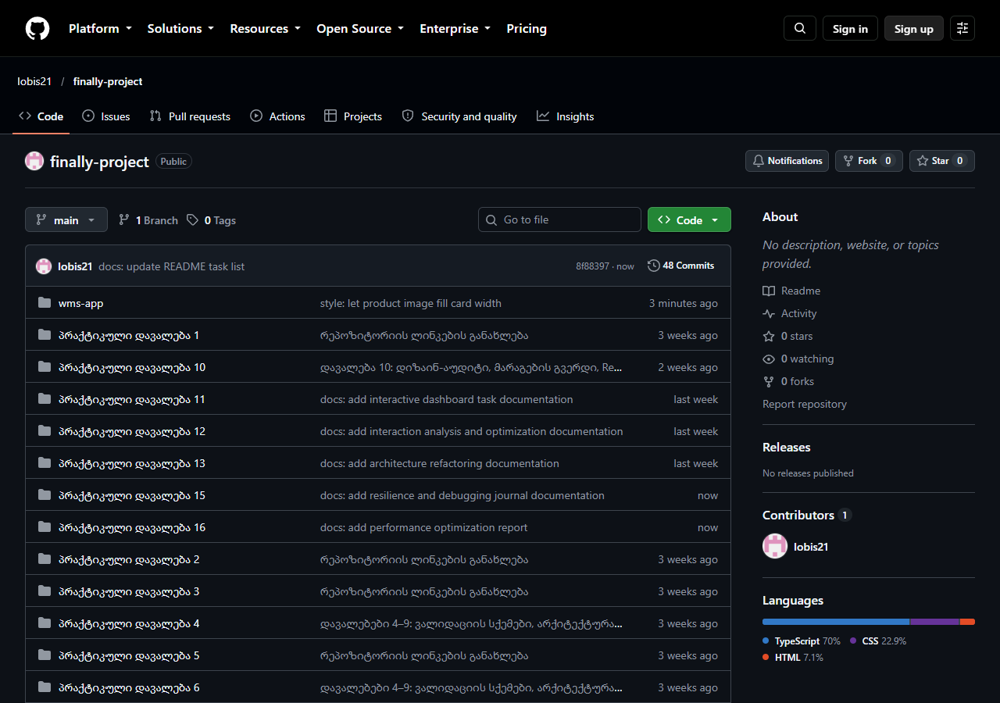
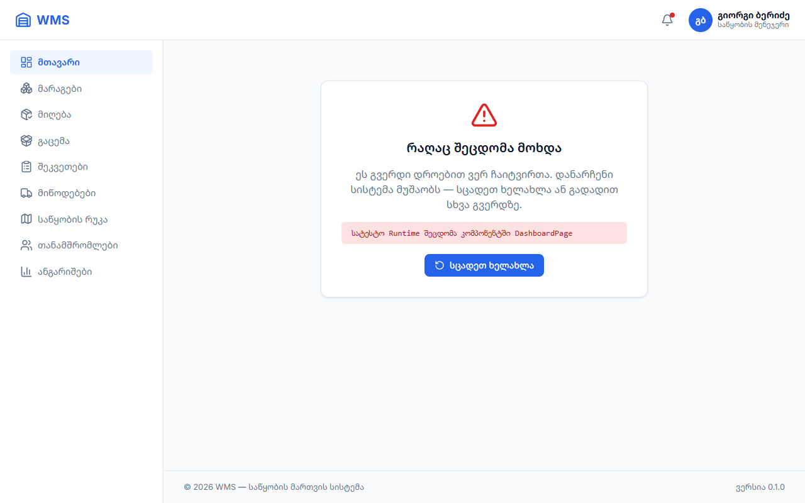
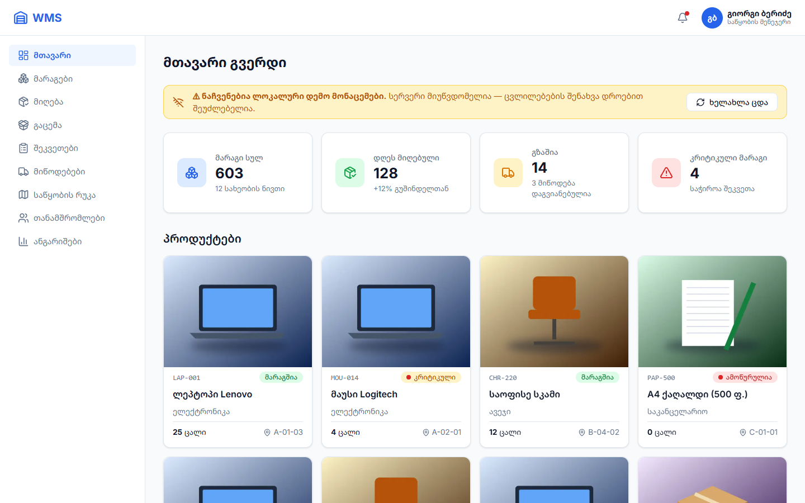
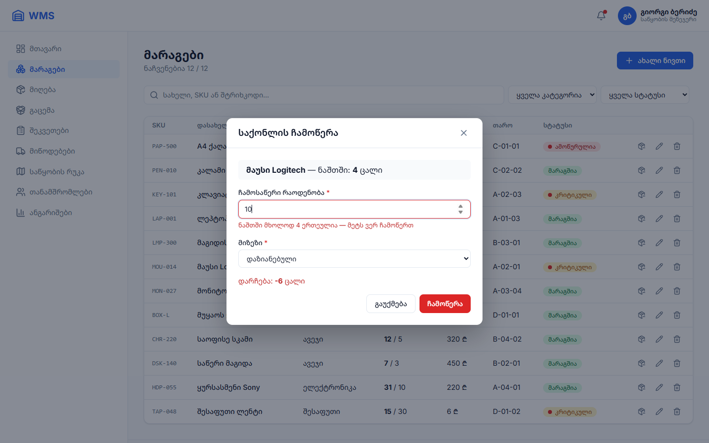
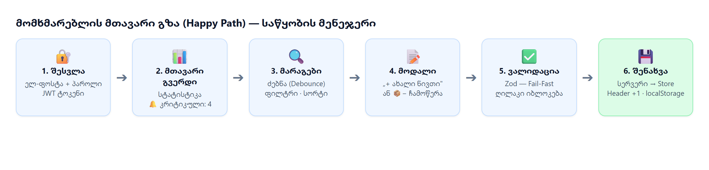
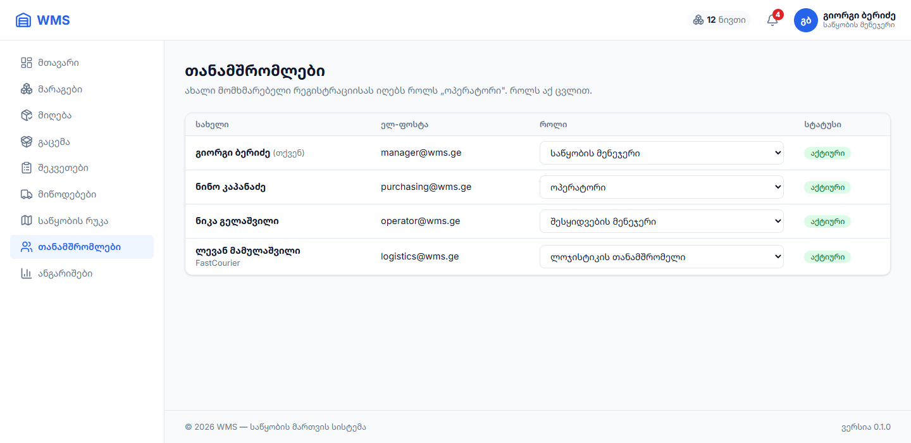

# საბოლოო ტექნიკური ანგარიში

**პროფესიული საგანმანათლებლო პროგრამა:** Front-end პროგრამირება

**მოდული:** პრაქტიკული პროექტი (რეგისტრაციის № 06.1.1.9)

| | |
|---|---|
| **სტუდენტი** | იობი შარაშენიძე |
| **შესრულების ფორმატი** | ინდივიდუალური |
| **პროექტის დასახელება და სფერო** | **WMS**, როლებზე დაფუძნებული საწყობის მართვის სისტემა (ვარიანტი №2) |
| **GitHub რეპოზიტორია** | https://github.com/Iobis21/finally-project |
| **Live Demo** | ეშვება ლოკალურად: `git clone` → `cd finally-project/wms-app` → `npm install` → `npm run dev` |
| **სატესტო ანგარიში** | `manager@wms.ge` / `Wms12345!` |

---

# სწავლის შედეგი 1: სამუშაოს დაგეგმვა და ორგანიზება

## 1.1. სამუშაო გეგმა, ეტაპები (Milestones) და რისკების განსაზღვრა

**პროექტის მიზანი და ბიზნეს-ამოცანა.** მცირე და საშუალო საწყობებში მარაგი ხშირად ქაღალდზე ან Excel-ში აღირიცხება. ამის გამო საქონელი იკარგება, ნაშთი რეალობას არ ემთხვევა და პროდუქტი მოულოდნელად მთავრდება, რადგან დროულად არავინ შეუკვეთა. WMS ამ პროცესს ერთ ვებ-სისტემაში აერთიანებს: მარაგი ჩანს რეალურ დროში, კრიტიკული ნაშთი ავტომატურად ინიშნება, ჩამოწერა უარყოფითი ნაშთისგან დაცულია. სამიზნე მომხმარებლები საწყობის თანამშრომლები არიან ოთხი როლით: **საწყობის მენეჯერი, შესყიდვების მენეჯერი, ოპერატორი და ლოჯისტიკა**. თითოეულს მხოლოდ თავისი სამუშაო სივრცე უჩანს.

**განხორციელების ეტაპები და ვადები:**

| ეტაპი | პერიოდი | რა გაკეთდა | შედეგი |
|---|---|---|---|
| **I. დაგეგმვა და არქიტექტურა** | 28.09 – 14.10 | ტექნიკური დავალება, როლები და უფლებების მატრიცა, API ენდფოინთები, Timeline (Google Sheets), GitHub Projects-ის კანბან დაფა Story Points-ით, User Flow, ვაიერფრეიმები | დავალებები 1–7 |
| **II. მარკირება, დიზაინ-სისტემა და UI** | 15.10 – 28.10 | სემანტიკური HTML5 სკელეტი, Design Tokens (CSS ცვლადები, Tailwind `@theme`), Grid/Flexbox ლეიაუთი, რეიუზებადი კომპონენტები, UI/UX აუდიტი | დავალებები 8–10 |
| **III. ფუნქციონალი, CRUD და State** | 29.10 – 20.11 | React Router, მარაგების CRUD, Portal მოდალები, Zod ვალიდაცია, json-server, JWT ავტორიზაცია, RBAC, ჩამოწერა, გლობალური Store (Context + useReducer) + localStorage | დავალებები 11–13, 19 |
| **IV. ოპტიმიზაცია, ტესტირება, დოკუმენტაცია** | 21.11 – დასრულება | ErrorBoundary, ოფლაინ რეჟიმი, memo / lazy / WebP, Lighthouse, კროს-ბრაუზერული ტესტირება (90 კომბინაცია), README, ანგარიშები | დავალებები 15–23 |

**იდენტიფიცირებული რისკები და მათი პრევენცია:**

| # | რისკი | პრევენცია კოდში |
|---|---|---|
| 1 | **მონაცემების დაკარგვა Refresh-ისას** | გლობალური Store სინქრონდება `localStorage`-თან: საწყისი state იკითხება `useReducer(reducer, undefined, loadInitialState)`-ით, ყოველი ცვლილება კი ინახება `useEffect`-ით. სესია (JWT) ცალკე ინახება |
| 2 | **ორმაგი ჩამოწერა / Double-Click / Race Condition** (ორი ოპერატორი ერთდროულად) | გაგზავნისას ღილაკი disabled-ია (`isSubmitting`), ფრონტენდზე მოქმედებს Zod `.max(stock)`, ჩაწერამდე კი სერვერიდან მოწმდება **უახლესი** ნაშთი (`getItem(id)`). ჩატვირთვებს თავისი ნომერი აქვს (`requestIdRef`), ამიტომ ძველი პასუხი ახალს ვერ გადაფარავს |
| 3 | **სერვერის გათიშვა** | Offline Fallback: ჩანს ბოლოს შენახული ან დემო მონაცემები და ბანერი, ცვლილების ღილაკები კი იმალება |
| 4 | **ვადების გადაჭარბება** (დიდი სფერო, ერთი დეველოპერი) | MVP პრიორიტეტით: ავტორიზაცია → მარაგები → CRUD → State. მეორეხარისხოვანი მოდულები (მიღება, შეკვეთები, რუკა) გადავიდა v2.0-ში, ინტერფეისში კი მათ ნაცვლად ჩანს „მზადდება“ |

## 1.2. რესურსებისა და მეთოდების შერჩევა

| სფერო | ტექნოლოგია | დასაბუთება |
|---|---|---|
| **Core & Build** | React 19, Vite, TypeScript | React: კომპონენტური UI. Vite: სწრაფი dev სერვერი და Code Splitting. TypeScript: ბევრი ტიპის მონაცემია (ნივთი, მომხმარებელი, როლი) და ტიპები შეცდომას კოდის გაშვებამდე იჭერს |
| **Styling & UI** | Tailwind CSS v4 + CSS ცვლადები + BEM CSS | დიზაინ-ტოკენები (ფერები, 8px ბადე, რადიუსი) ერთ ადგილას (`@theme`, `:root`). ლეიაუთი კომპონენტურ CSS ფაილებშია (Grid/Flexbox). იკონები: Lucide (SVG) |
| **State & Persistence** | Context API + `useReducer` + localStorage; json-server (db.json) | Store დამატებითი ბიბლიოთეკის გარეშე. action → reducer → state პრინციპი (Redux-ის მსგავსი). json-server იძლევა რეალურ REST API-ს |
| **Auth** | json-server-auth (JWT, bcrypt) | რეალური შესვლა და რეგისტრაცია ტოკენით და დაშიფრული პაროლით |
| **Validation & Forms** | React Hook Form + Zod | RHF: ფორმები ზედმეტი რენდერის გარეშე. Zod: წესები ქართული შეცდომებით, ტიპები ავტომატურად |
| **სამუშაო ინსტრუმენტები** | VS Code, Git & GitHub, GitHub Projects, Chrome DevTools, Lighthouse, Prettier, Oxlint, puppeteer (E2E ტესტები) | — |

## 1.3. პროფესიული პასუხისმგებლობები და კომუნიკაცია

**როლების შეთავსება (ინდივიდუალური პროექტი).** Full-cycle დეველოპერის ყველა როლი ერთმა ადამიანმა შეითავსა:

| როლი | შესრულებული სამუშაო |
|---|---|
| **პროდუქტი / ლიდი** | ტექნიკური დავალება, ეტაპები, რისკები, კანბან დაფა, Story Points |
| **UI/UX დიზაინერი** | User Flow, ვაიერფრეიმები, Design Tokens, რესპონსივი 320–1440px, UI/UX აუდიტი, კონტრასტი WCAG AA |
| **Front-end არქიტექტორი** | საქაღალდეების სტრუქტურა, SOLID ფენები (component → hook/store → service → API), Routing, RBAC |
| **State / ბიზნეს-ლოგიკა** | გლობალური Store, CRUD, ჩამოწერის წესები, Race Condition-ის დაცვა |
| **QA ინჟინერი** | ავტომატური E2E ტესტები (puppeteer), Lighthouse, კროს-ბრაუზერული ტესტი (Chrome, Edge, Firefox), დებაგინგის ჟურნალი |
| **ტექნიკური მწერალი** | README, 23 დავალების დოკუმენტაცია, ანგარიშები |

**სამუშაოს კოორდინაცია.** ამოცანები იგეგმებოდა **GitHub Projects**-ის კანბან დაფაზე (Backlog → To Do → In Progress → Code Review / QA → Done) Story Points-ით. ყოველი ცვლილება ცალკე, პატარა commit-ად იტვირთებოდა (Conventional Commits). ფინალური დოკუმენტაცია გაკეთდა ცალკე ბრენჩზე (`docs/final-readme`) და შეუერთდა **Pull Request #1**-ით. ყოველი ფუნქციის შემდეგ კოდი მოწმდებოდა: `tsc -b` (ტიპები), `npm run build`, ბრაუზერის ავტოტესტი.

---

# სწავლის შედეგი 2: პროფესიული ამოცანის დამოუკიდებლად შესრულება

## 2.1. ვებგვერდის არქიტექტურა და მარკირება (HTML5)

**საქაღალდეების მოდულური სტრუქტურა:**


| საქაღალდე | დანიშნულება |
|---|---|
| `components/` | მხოლოდ UI: რეიუზებადი კომპონენტები (Modal, Button, Header, ErrorBoundary …) |
| `pages/` | გვერდები, რომლებიც კომპონენტებს აერთიანებენ |
| `store/` | გლობალური Store: reducer, Context, localStorage |
| `hooks/` | ლოგიკა UI-ს გარეშე: `useItems`, `useInventoryFilters`, `useDebounce` |
| `services/` | ყველა HTTP მოთხოვნა: კომპონენტებში არცერთი `fetch` არ არის (Dependency Inversion) |
| `types/`, `schemas/` | TypeScript ინტერფეისები და Zod სქემები |



**სემანტიკური HTML5 და Accessibility:**
- **თეგები:**
  - `<header>`: Header;
  - `<aside>` + `<nav aria-label>`: მენიუ;
  - `<main>`: გვერდის შიგთავსი;
  - `<section>`: სტატისტიკა და პროდუქტები;
  - `<article>`: თითო ბარათი;
  - `<footer>`;
  - ცხრილში `<th scope>` და `aria-sort`, ბარათებში `<dl>/<dt>/<dd>`;
  - მოდალს აქვს `role="dialog"` და `aria-modal`;
- **Accessibility:**
  - იკონა-ღილაკებს აქვთ `aria-label` (მაგ. „წაშლა: ლეპტოპი Lenovo“), ფორმის ველებს `aria-invalid` და `aria-describedby`;
  - კლავიატურით ნავიგაცია: Tab / Enter, **Escape** ხურავს მოდალს და მენიუს, მოდალში ფოკუსი პირველ ველზე გადადის, დახურვისას კი უკან ბრუნდება;
  - `:focus-visible` ჩარჩო;
  - Badge-ების კონტრასტი 2.86:1-დან 4.5:1+-მდე გაუმჯობესდა;
  - `prefers-reduced-motion`;
- **SEO:** `lang="ka"`, `<title>`, `meta description`, `robots.txt`. **Lighthouse SEO 100, Accessibility 100.**

## 2.2. ვიზუალური სტილი და რესპონსივობა

**დიზაინ-სისტემა:**
- **ფერები:** primary `#2563EB`, success / warning / danger / info სტატუსები, ცალკე მუქი ტექსტით (WCAG AA);
- **ტიპოგრაფია:** Inter + Noto Sans Georgian;
- **დაშორებები:** 8px ბადე (4 / 8 / 16 / 24 / 32);
- **რადიუსი და ჩრდილი:** CSS ცვლადებად (`:root`), Tailwind-ში კი `@theme`-ით.

**CSS Grid და Flexbox:**

| სად | რა | რატომ |
|---|---|---|
| გვერდის ჩონჩხი | **CSS Grid** `260px 1fr` + `grid-template-areas` | ორგანზომილებიანი განლაგება: Header, Sidebar, Main, Footer |
| სტატისტიკა / პროდუქტები | **Grid** `repeat(auto-fit, minmax(220px, 1fr))` | ბარათები თავისით გადადიან ახალ ხაზზე, მედია-ქიერის გარეშე |
| Header, ბარათის შიგნით, ფილტრები | **Flexbox** (`space-between`, `gap`) | ერთგანზომილებიანი: ელემენტები ერთ ხაზზე |

**რესპონსიული ადაპტაცია:**

| ეკრანი | ქცევა |
|---|---|
| **Desktop 1440px** | Sidebar მუდმივად ჩანს, ცხრილი 8 სვეტით, 4 ბარათი ხაზზე |
| **Tablet 768px** | Sidebar იმალება და ☰-ით იხსნება, ფილტრები ერთ ხაზზე, ცხრილი ბარათებად |
| **Mobile 375px** | ერთსვეტიანი ბადე, ჰამბურგერ მენიუ (transform: translateX, Esc ხურავს), 2×2 სტატისტიკა, მოდალი მთელ ეკრანზე |

შემოწმდა **Chrome, Edge და Firefox**, 6 მოწყობილობაზე (320–1440px), სულ 90 კომბინაცია, ჰორიზონტალური სქროლის გარეშე.



| მობილური, 375px | ჰამბურგერ მენიუ | პლანშეტი, 768px |
|---|---|---|
|  |  |  |

## 2.3. ინტერაქტიული ელემენტები და ფუნქციონალი

**CRUD და State Management:**

| ოპერაცია | რა | როგორ |
|---|---|---|
| **Create** | ნივთის დამატება, რეგისტრაცია | მოდალი + Zod → `POST /items` → `dispatch({ type: 'ADD_ITEM' })` |
| **Read** | ცხრილი/ბარათები, სტატისტიკა, თანამშრომლები | Store-იდან `useInventory()` |
| **Update** | რედაქტირება, **ჩამოწერა**, როლის შეცვლა, დაბლოკვა | `PATCH` → `UPDATE_ITEM` |
| **Delete** | ნივთის წაშლა დადასტურებით | `DELETE` → `DELETE_ITEM` |

**კომპონენტებს შორის კავშირი:** მოდალში ნივთის დამატებისას ერთდროულად ახლდება ცხრილი, **Header-ის მრიცხველი (12 → 13)**, 🔔 კრიტიკული მარაგის ნიშანი (4 → 5) და Dashboard-ის სტატისტიკა. ეს ხდება Prop Drilling-ის გარეშე, რადგან ყველა ერთსა და იმავე Store-ს კითხულობს. ყველაფერი ინახება `localStorage`-ში (`wms-inventory`) და `db.json`-ში.



**ძიება, ფილტრაცია, მოდალები და ვალიდაცია:**
- **ძიება:** ცოცხალი ძიება სახელით, SKU-ით ან შტრიხკოდით (`useDebounce`, 300ms), ფილტრი კატეგორიით და სტატუსით, სორტირება სვეტზე დაჭერით;
- **მოდალები:** `ReactDOM.createPortal(…, document.body)`. იხურება ✕-ით, ფონზე დაჭერით ან Escape-ით;
- **Fail-Fast ვალიდაცია (Zod):**
  - SKU-ს ფორმატი (`LAP-001`), 13-ციფრიანი შტრიხკოდი, თაროს ფორმატი (`A-01-03`);
  - პაროლი: 8 სიმბოლო, ციფრი და სიმბოლო;
  - ჩამოწერა: ნაშთზე მეტი არა.


## 2.4. ვერსიების კონტროლი (Git / GitHub)

- **`.gitignore`:** `node_modules`, `dist`, `.env`, `.env.*` (სანიმუშოდ რჩება `.env.example`), `*.local`, დროებითი ფაილები;
- **ბრენჩები:** `main` სტაბილური ვერსიაა. ფინალური დოკუმენტაცია გაკეთდა ბრენჩზე **`docs/final-readme`** და შეუერთდა **Pull Request #1**-ით;
- **კომიტები:** 70-მდე ატომური, სემანტიკური commit (Conventional Commits). არცერთი „დიდი“ commit, რომელიც მთელ პროექტს ერთად ატვირთავს:

```text
feat: add stock write-off with negative stock and race condition protection
feat: add InventoryProvider with useReducer as single source of truth
fix: consistent Georgian name sorting across Chrome and Edge
fix: ignore stale item responses and use unique console timers
refactor: move items and filters from local state to global inventory store
perf: lazy load route pages with React.lazy and Suspense
perf: add category images as WebP with lazy loading
docs: create comprehensive project README documentation
```



## 2.5. ოპტიმიზაცია და პრობლემების გადაჭრა

**წარმადობის ოპტიმიზაცია:**

| ტექნიკა | შედეგი |
|---|---|
| `useDebounce` (300ms) | ძიება იწყება ბეჭდვის შეწყვეტის შემდეგ და არა ყოველ ასოზე |
| `useMemo` / `useCallback` / `React.memo` | ცხრილის რიგები ზედმეტად აღარ იხატება. რედაქტირებისას იხატება მხოლოდ 1 რიგი |
| `React.lazy` + `Suspense` | მთავარი JS **429 kB → 267 kB** (−38%) |
| WebP + `loading="lazy"` + SVG იკონები | სურათები **8.3 MB → 8.9 KB** |
| Event Delegation | 1 მსმენელი ცხრილზე, 24-ის ნაცვლად |
| GPU ანიმაციები | მხოლოდ `transform` / `opacity` |
| **Lighthouse** | Performance **95–100**, Accessibility, Best Practices და SEO **100** |


**სისტემის მდგრადობა:**
- **ErrorBoundary:** Runtime შეცდომისას თეთრი ეკრანის ნაცვლად ჩანს Fallback და „სცადეთ ხელახლა“. Header და მენიუ განაგრძობს მუშაობას;
- **Double-Click:** გაგზავნისას ღილაკი disabled-ია და წერია „ინახება...“;
- **Race Condition:** მოთხოვნებს თავისი ნომერი აქვს, ჩამოწერამდე კი სერვერიდან უახლესი ნაშთი მოწმდება;
- **Offline / Fallback:** სერვერის 500-ისას ან ინტერნეტის გაწყვეტისას ჩანს localStorage-ის ან დემო მონაცემები და ბანერი.

| ErrorBoundary | Offline Fallback | უარყოფითი ნაშთის დაცვა |
|---|---|---|
|  |  |  |

**გადაჭრილი ტექნიკური პრობლემები:**

**ქეისი 1: ქართული სორტირება ბრაუზერებში განსხვავდებოდა.** კროს-ბრაუზერულ ტესტზე აღმოჩნდა, რომ დასახელებით დალაგებისას Chrome-ში „A4 ქაღალდი“ პირველია, Edge-ში კი ბოლო. DevTools-მა აჩვენა, რომ `new Intl.Collator('ka')` Chrome-ში აბრუნებს `en-GB`-ს (ქართული ენის წესები მასში არ არის), Edge-ში კი `ka`-ს.
➔ **გადაწყვეტა:** დაიწერა ბრაუზერისგან დამოუკიდებელი `compareNames()`: ჯერ ქართული სახელები (მხედრული Unicode-ში ანბანის რიგითაა), შემდეგ ლათინური. ახლა სამივე ბრაუზერში დალაგება იდენტურია.

**ქეისი 2: ძველი პასუხი ახალს გადაფარავდა (Race Condition).** კონსოლში ჩნდებოდა `Timer 'items:load' already exists`. Breakpoint-მა აჩვენა, რომ ჩატვირთვა ერთდროულად ორჯერ ეშვებოდა (StrictMode და „ხელახლა ცდა“), ხოლო ნელ, ძველ პასუხს შეეძლო ახალი მონაცემების გადაფარვა.
➔ **გადაწყვეტა:** `requestIdRef`: პასუხი მიიღება, მხოლოდ თუ ის ბოლოა. ტაიმერის სახელიც უნიკალური გახდა. იგივე პრინციპით ჩამოწერამდე სერვერიდან უახლესი ნაშთი მოწმდება.

> დამატებით გადაჭრილია: Vite-ის მიერ გვერდის გადატვირთვა `db.json`-ის ცვლილებისას, ErrorBoundary და React 19-ის render retry, ცხრილის გაჭრა 820px-იან პლანშეტზე, CLS 0.168 → 0.017.

---

# სწავლის შედეგი 3: შესრულებული ამოცანების ანგარიშგება

## 3.1. პროექტის ტექნიკური დოკუმენტაცია (README.md)

✅ რეპოზიტორიის ძირეულ საქაღალდეში განთავსებულია სრულყოფილი **README.md** 7 სავალდებულო სექციით:
1. სათაური, სლოგანი და Live Demo;
2. ბიზნეს-აღწერა სქრინით;
3. ძირითადი ფუნქციონალი;
4. ტექნოლოგიური სტეკის ცხრილი;
5. საქაღალდეების სტრუქტურა;
6. გაშვების ინსტრუქცია;
7. სატესტო ანგარიშები და სკრიპტები.

Vite-ის სტანდარტული ტექსტი წაშლილია. README-ში აღწერილია მხოლოდ ის ტექნოლოგიები, რომლებიც კოდში რეალურად გამოიყენება.

**გაშვება:**
```bash
git clone https://github.com/Iobis21/finally-project.git
cd finally-project/wms-app
npm install
npm run dev        # http://localhost:5173 (საიტი) + http://localhost:3000 (API)
```

**სატესტო ანგარიშები** (პაროლი `Wms12345!`): `manager@wms.ge` (მენეჯერი), `purchasing@wms.ge`, `operator@wms.ge`, `logistics@wms.ge`.

**დამატებითი დოკუმენტაცია:** 23 პრაქტიკული დავალების ანგარიში რეპოზიტორიაშია (`პრაქტიკული დავალება N/`).

## 3.2. პრეზენტაცია და პროდუქტის წარდგენა

**დემონსტრირების სცენარი (Happy Path):**



| # | ნაბიჯი | რას ვაჩვენებ |
|---|---|---|
| 1 | **შესვლა** `operator@wms.ge`-ით | მენიუში მხოლოდ 4 გვერდია, დამატების ღილაკი არ ჩანს: **RBAC** |
| 2 | **გასვლა → შესვლა** `manager@wms.ge`-ით | ყველა გვერდი, Header-ში „12 ნივთი“ და 🔔 4 |
| 3 | **მარაგები → ძებნა** „ლეპ“ | 300ms-ის შემდეგ 1 შედეგი (**Debounce**), ფილტრი „კრიტიკული“, სორტირება |
| 4 | **„+ ახალი ნივთი“ → ცარიელი გაგზავნა** | **Portal მოდალი**, Zod-ის 6 შეცდომა ველების ქვეშ |
| 5 | **შევსება → შენახვა** | ცხრილი განახლდა, **Header 12 → 13**, Refresh-ის გარეშე (**Store**) |
| 6 | **F5 (Refresh)** | ნივთი და ფილტრები დარჩა (**localStorage**) |
| 7 | **📦− ჩამოწერა** ნაშთზე მეტის | „ნაშთში მხოლოდ 4 ერთეულია“ (**უარყოფითი ნაშთის დაცვა**) |
| 8 | **თანამშრომლები** | ოპერატორს როლი ეცვლება „ლოჯისტიკაზე“ |
| 9 | **F12 → ტელეფონის ხედი** | 375px, ☰ მენიუ, ცხრილი ბარათებად |
| 10 | **API-ს გაჩერება → F5** | ოფლაინ ბანერი და შენახული მონაცემები (**Resilience**) |



**შეჯამება.** შეიქმნა სრულფასოვანი, როლებზე დაფუძნებული საწყობის მართვის ვებ-აპლიკაცია. მას აქვს:
- რეალური ავტორიზაცია და CRUD;
- გლობალური Store localStorage-თან სინქრონიზაციით;
- ვალიდაცია და დაცვითი მექანიზმები;
- რესპონსივი 320–1440px სამ ბრაუზერში;
- Lighthouse-ის ქულები 95–100.

მუშაობა სრულად იყო დაგეგმილი, დოკუმენტირებული და Git-ით მართული: 23 დავალება და 70-მდე სემანტიკური commit.

**სამომავლო განვითარების გეგმა (Version 2.0):**

| # | ფუნქცია | აღწერა |
|---|---|---|
| 1 | **საქონლის მიღება შტრიხკოდით (Inbound)** | ოპერატორი ასკანერებს ტვირთს, სისტემა ადარებს შეკვეთას და ნაშთი ავტომატურად იზრდება |
| 2 | **შესყიდვის შეკვეთები (Purchase Orders)** | კრიტიკული მარაგიდან ერთი დაჭერით იქმნება შეკვეთა → მენეჯერის დამტკიცება → მიღება |
| 3 | **Live Demo და რეალური ბაზა** | ფრონტენდი Vercel-ზე, ბექენდი Render-ზე / Supabase (PostgreSQL) |

დამატებით: გაცემა (Picking/Packing), საწყობის ვიზუალური რუკა, ანგარიშები და გრაფიკები, Unit ტესტები (Vitest) და CI.
