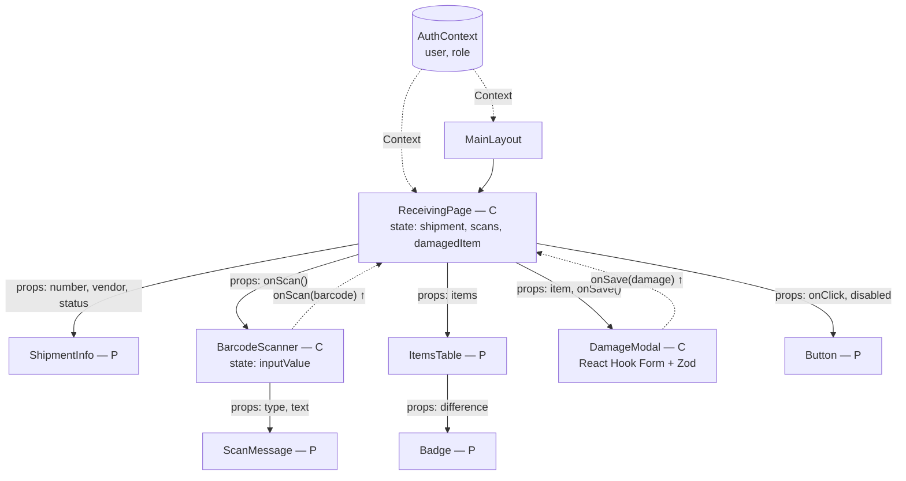

# WMS — ტექნიკური დავალება და არქიტექტურა

**პრაქტიკული დავალება 5**  
სრული ტექნიკური დავალება: [TECH_SPEC.md](../პრაქტიკული%20დავალება%201/TECH_SPEC.md) · ტიპები კოდში: [wms-app/src/types/index.ts](../wms-app/src/types/index.ts)

---

## 1. პროექტის მიზანი და ბიზნეს-ლოგიკა

**პრობლემა:** ბევრ საწყობში მარაგები ჯერ კიდევ Excel-ში ან ქაღალდზე აღირიცხება. ამის გამო:
- უცნობია, რეალურად რამდენი საქონელია და სად დევს;
- საქონელი მოულოდნელად ამოიწურება, რადგან დროულად არავინ შეუკვეთა;
- მიღებისას შეცდომები ხდება (ნაკლები ან არასწორი საქონელი);
- თანამშრომლები ერთმანეთის სამუშაოში ერევიან.

**გადაწყვეტა:** ვებ-აპლიკაცია, სადაც ყველა ოპერაცია ერთ სისტემაშია და თითოეულ თანამშრომელს აქვს თავისი სამუშაო სივრცე.

**მომხმარებლები (როლები):** საწყობის მენეჯერი, შესყიდვების მენეჯერი, ოპერატორი, ლოჯისტიკის თანამშრომელი.

---

## 2. ფუნქციონალური მოთხოვნები

### საწყობის მენეჯერი
- ხედავს Dashboard-ს: მარაგი სულ, დღეს მიღებული, გზაში, კრიტიკული მარაგი;
- ხედავს და ფილტრავს მარაგების ცხრილს;
- ხედავს საწყობის რუკას (ზონები, თაროები, დატვირთვა);
- აღრიცხავს წუნდებულ საქონელს;
- ამტკიცებს ან უარყოფს შესყიდვის შეკვეთებს;
- ამატებს, არედაქტირებს და ბლოკავს თანამშრომლებს;
- ხედავს ანგარიშებს.

### შესყიდვების მენეჯერი
- მართავს მომწოდებლების სიას;
- ქმნის შესყიდვის შეკვეთას;
- იღებს შეტყობინებას კრიტიკულ მარაგზე;
- ხედავს თავისი შეკვეთების სტატუსს.

### ოპერატორი
- ხედავს დღის ამოცანებს (მისაღები ტვირთები, გასაცემი შეკვეთები);
- იღებს საქონელს შტრიხკოდის სკანირებით;
- აღნიშნავს დაზიანებულ ერთეულებს;
- აგროვებს (Picking) და ფუთავს (Packing) შეკვეთებს.

### ლოჯისტიკის თანამშრომელი
- ხედავს მიწოდებების სიას;
- ირჩევს კურიერს;
- ცვლის მიწოდების სტატუსს (მოლოდინში → გზაშია → მიწოდებულია / ვერ მიწოდდა).

---

## 3. არაფუნქციონალური მოთხოვნები

| სფერო | როგორ ვუზრუნველყოფ |
|---|---|
| **რესპონსივობა** | Mobile-first მიდგომა; Tailwind-ის breakpoint-ები (`sm`, `md`, `lg`); CSS Grid `auto-fit`; მობილურზე ჰამბურგერ მენიუ; ოპერატორი იყენებს პლანშეტს — დიდი ღილაკები (მინ. 44px) |
| **კოდის სისუფთავე** | TypeScript (ტიპები ყველგან); ერთი კომპონენტი = ერთი ფაილი; ფოლდერები ფუნქციის მიხედვით; ESLint/Oxlint; Prettier; გასაგები სახელები; commit-ები ფორმატით `add ...`, `fix ...` |
| **სისწრაფე** | Vite (სწრაფი build); გვერდების Lazy loading (`React.lazy`); ცხრილებში პაგინაცია (არა ყველა ჩანაწერი ერთად); ძებნაზე debounce (300ms); სურათები `loading="lazy"` |
| **ხელმისაწვდომობა (a11y)** | სემანტიკური HTML (`header`, `nav`, `main`, `aside`); `label` ყველა ველს; `aria-label` იკონა-ღილაკებს; ხილული ფოკუსი (`:focus-visible`); ფერის კონტრასტი მინ. 4.5:1; კლავიატურით ნავიგაცია; სტატუსი არა მხოლოდ ფერით, არამედ ტექსტითაც |
| **უსაფრთხოება** | JWT ტოკენი; დაცული მარშრუტები; როლების შემოწმება; პაროლის მოთხოვნები (მინ. 8, ციფრი, სიმბოლო) |

---

## 4. ტექნოლოგიური სტეკი

| ბიბლიოთეკა / ინსტრუმენტი | დანიშნულება |
|---|---|
| **React 19** | UI ბიბლიოთეკა |
| **Vite** | პროექტის აწყობა და dev სერვერი |
| **TypeScript** | ტიპიზაცია |
| **Tailwind CSS v4** | სტილები, დიზაინ-სისტემა |
| **React Router** | მარშრუტიზაცია, დაცული გვერდები |
| **Lucide Icons** (`lucide-react`) | იკონები |
| **React Hook Form + Zod** | ფორმები და ვალიდაცია |
| **TanStack Table** | ცხრილები (პაგინაცია, სორტირება, ფილტრი) |
| **Recharts** | გრაფიკები |
| **json-server + json-server-auth** | Mock API და JWT ავტორიზაცია |
| **Git / GitHub** | ვერსიების კონტროლი — [Iobis21/finally-project](https://github.com/Iobis21/finally-project) |
| **GitHub Projects** | თასქების მართვა |
| **Vercel** | Deploy |

---

## 5. ფოლდერების სტრუქტურა

```
src/
├── components/              # გლობალური, რეიუზებადი კომპონენტები
│   ├── ui/                  # Button, Input, Badge, Modal, Spinner, Skeleton
│   ├── table/               # DataTable, Pagination
│   ├── Header/              # Header.tsx + Header.css
│   ├── Sidebar/             # Sidebar.tsx + Sidebar.css
│   ├── Footer/
│   ├── StatCard/            # სტატისტიკის კარტა
│   └── ProductCard/         # პროდუქტის კარტა
│
├── layouts/                 # მთავარი ლეიაუთები როლების მიხედვით
│   ├── AuthLayout.tsx       # შესვლის გვერდი (ცენტრში ბარათი)
│   ├── MainLayout.tsx       # Header + Sidebar + Main + Footer
│   └── OperatorLayout.tsx   # გამარტივებული, პლანშეტისთვის (დიდი ღილაკები)
│
├── pages/                   # გვერდის დონის კომპონენტები
│   ├── auth/                # LoginPage
│   ├── dashboard/           # DashboardPage
│   ├── inventory/           # InventoryPage, ItemDetailsPage, AdjustPage
│   ├── inbound/             # InboundListPage, ReceivingPage
│   ├── outbound/            # OutboundListPage, PickingPage, PackingPage
│   ├── orders/              # OrdersPage, CreateOrderPage, OrderDetailsPage
│   ├── vendors/             # VendorsPage
│   ├── deliveries/          # DeliveriesPage
│   ├── users/               # UsersPage, CreateUserPage
│   ├── reports/             # ReportsPage
│   └── errors/              # NotFoundPage, ForbiddenPage
│
├── api/                     # მოთხოვნები სერვერთან
│   ├── client.ts            # fetch-ის საერთო ფუნქცია (ტოკენის დამატება)
│   ├── auth.api.ts          # login(), logout()
│   ├── items.api.ts         # getItems(), getItem(), updateItem()
│   ├── orders.api.ts        # getOrders(), createOrder(), approveOrder()
│   └── shipments.api.ts     # getShipment(), saveReceiving()
│
├── context/                 # AuthContext
├── routes/                  # ProtectedRoute, RoleRoute, router.tsx
├── types/                   # TypeScript ინტერფეისები
├── hooks/                   # useAuth, useDebounce, useBarcodeScanner, useFetch
├── schemas/                 # Zod სქემები
├── utils/                   # formatPrice(), formatDate(), getStockStatus()
├── data/                    # დროებითი სატესტო მონაცემები
├── App.tsx
├── main.tsx
└── index.css                # გლობალური სტილები
```

---

## 6. კომპონენტების ხე — საქონლის მიღების გვერდი

**C** = Container (Smart) — მართავს სტეიტს და ლოგიკას  
**P** = Presentational (Dumb) — იღებს props-ს და მხოლოდ აჩვენებს



**მონაცემების მიმოცვლა:**
- **Context API** — `AuthContext` (ვინ არის შესული, რა როლი აქვს). ყველა გვერდს სჭირდება, ამიტომ Props Drilling-ის ნაცვლად Context-ს ვიყენებ;
- **Props (ზემოდან ქვემოთ)** — `ReceivingPage` შვილებს გადასცემს მონაცემებს;
- **Callback-ები (ქვემოდან ზემოთ)** — `BarcodeScanner` იძახებს `onScan()`-ს, `ReceivingPage` ცვლის სტეიტს და ცხრილი ხელახლა რენდერდება (Lifting State Up).

---

## 7. მარშრუტები და როლების მატრიცა

**აბრევიატურები:** M — საწყობის მენეჯერი · P — შესყიდვები · O — ოპერატორი · L — ლოჯისტიკა

| მარშრუტი | ტიპი | M | P | O | L |
|---|---|:---:|:---:|:---:|:---:|
| `/login` | 🌐 Public (მხოლოდ შეუსვლელი) | — | — | — | — |
| `/about` | 🌐 Public | ✅ | ✅ | ✅ | ✅ |
| `/` (Dashboard) | 🔒 Protected | ✅ | ✅ | ✅ | ✅ |
| `/inventory` | 🔒 Protected | ✅ | ✅ | ✅ | ✅ |
| `/inventory/:id` | 🔒 Protected | ✅ | ✅ | ✅ | ✅ |
| `/inventory/adjust` | 🛡️ RBAC | ✅ | ❌ | ✅ | ❌ |
| `/inbound` | 🛡️ RBAC | ✅ | ✅ | ✅ | ❌ |
| `/inbound/:id` | 🛡️ RBAC | ✅ | ❌ | ✅ | ❌ |
| `/outbound` | 🛡️ RBAC | ✅ | ❌ | ✅ | ✅ |
| `/outbound/pick/:id` | 🛡️ RBAC | ❌ | ❌ | ✅ | ❌ |
| `/outbound/pack/:id` | 🛡️ RBAC | ❌ | ❌ | ✅ | ❌ |
| `/orders` | 🛡️ RBAC | ✅ | ✅ | ❌ | ❌ |
| `/orders/new` | 🛡️ RBAC | ❌ | ✅ | ❌ | ❌ |
| `/orders/:id` | 🛡️ RBAC | ✅ | ✅ | ❌ | ❌ |
| `/vendors` | 🛡️ RBAC | ✅ | ✅ | ❌ | ❌ |
| `/deliveries` | 🛡️ RBAC | ✅ | ❌ | ❌ | ✅ |
| `/map` | 🛡️ RBAC | ✅ | ❌ | ❌ | ❌ |
| `/users`, `/users/new` | 🛡️ RBAC | ✅ | ❌ | ❌ | ❌ |
| `/reports` | 🛡️ RBAC | ✅ | ✅ | ❌ | ❌ |
| `/profile` | 🔒 Protected | ✅ | ✅ | ✅ | ✅ |
| `/403` | 🔒 Protected | ✅ | ✅ | ✅ | ✅ |
| `*` (404) | 🌐 Public | ✅ | ✅ | ✅ | ✅ |

- 🌐 **Public** — ავტორიზაცია არ სჭირდება;
- 🔒 **Protected** — სჭირდება შესვლა (`ProtectedRoute`), თუ არა — გადამისამართება `/login`-ზე;
- 🛡️ **RBAC** — სჭირდება კონკრეტული როლი (`RoleRoute`), თუ არა — `/403`.

---

## 8. TypeScript ინტერფეისები

სრული ფაილი: [wms-app/src/types/index.ts](../wms-app/src/types/index.ts)

```ts
export type Role = 'manager' | 'purchasing' | 'operator' | 'logistics'

export interface User {
  id: number
  firstName: string
  lastName: string
  email: string
  phone?: string
  role: Role
  userType: 'individual' | 'company'
  companyName?: string
  isActive: boolean
  createdAt: string
}

export interface Item {
  id: number
  sku: string
  barcode: string
  name: string
  category: string
  quantity: number
  minQuantity: number
  price: number
  location: string
}

export type OrderStatus = 'draft' | 'pending' | 'approved' | 'rejected' | 'received'

export interface PurchaseOrder {
  id: number
  number: string
  vendorId: number
  status: OrderStatus
  expectedDate: string
  note?: string
  createdBy: number
  createdAt: string
  items: { itemId: number; quantity: number; price: number }[]
}

export interface Shipment {
  id: number
  orderId: number
  status: 'expected' | 'receiving' | 'completed'
  items: { itemId: number; expected: number; received: number; damaged: number }[]
}
```
